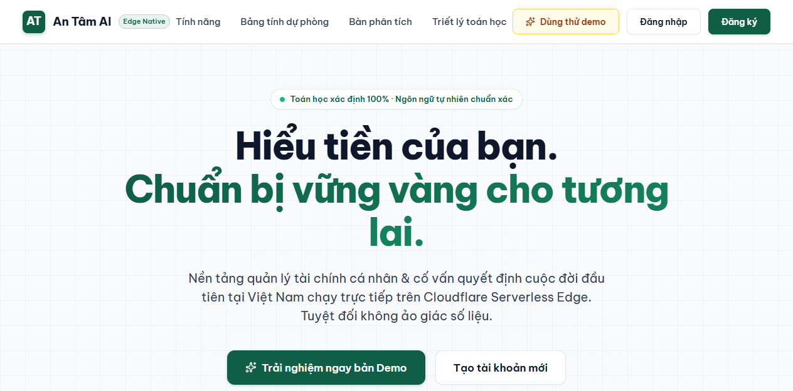

# 🛡️ An Tâm — Financial Resilience Terminal
> **Dự án tham dự:** 2026 Shenzhen International FinTech Competition (FinTechathon) – WeBank Challenge (International Track)  
> **Khẩu hiệu:** **Trước mỗi quyết định lớn, biết chắc mình có kham nổi không.** *(Know if you can afford your next big life decision — before you make it.)*  
> **Giải thích:** An Tâm nhìn cùng lúc tiền bạn đang có, công việc đang nuôi bạn, và những kế hoạch lớn bạn muốn làm — rồi cho bạn biết kế hoạch nào an toàn, kế hoạch nào cần chuẩn bị thêm.  
> **Triết lý nhân bản:** **"Giá trị của an tâm chính là AN TÂM!"** — Xây dựng theo **Thang Chống Chịu Tài Chính 5 bậc (Financial Resilience Ladder)**, lấy cảm hứng từ Tháp Nhu Cầu Maslow.  
> **Nguyên tắc sản phẩm:** **COMPLEXITY INSIDE. CLARITY OUTSIDE.** *(Viết đề tài có căn cứ lý thuyết vững chắc — Khi code thì bình dân, gần gũi, dễ tiếp cận để mang lại cuộc sống tốt đẹp hơn cho người dân).*

<div align="center">

[](https://opensource.org/licenses/MIT)
[](https://workers.cloudflare.com/)
[](https://developers.cloudflare.com/d1/)
[](https://react.dev/)
[](#)



</div>

---

## 🎯 CÁC CAM KẾT CỐT LÕI (CORE CLAIMS)

Mỗi cam kết đi kèm **bằng chứng trong mã nguồn** (✅) hoặc **đặc tả đã khóa kèm hạn triển khai** (📐). Bảng đối chiếu đầy đủ: [Báo cáo thẩm định tiền nộp bài](.agents/judge-review.md).

1. **CLAIM 1: Quản trị Tổng tài sản tích hợp Vốn con người (Human Capital & Career Risk)**
   - ✅ Lớp năng lực kiếm tiền: kế hoạch tăng thu nhập, giờ giá trị, phân bổ 168 giờ/tuần — `shared/engine/earn.ts`, `/api/earn`.
   - 📐 Định giá **Vốn con người** bằng dữ liệu phơi nhiễm GenAI theo nghề của **ILO (2025, 427 nghề ISCO-08)** — hạn 08/10.
   - 📐 **Chỉ số Tập trung Rủi ro Tổng tài sản** giữa ngành nghề và danh mục, cờ cổ phiếu công ty mình làm (ESOP), mô phỏng *trước khi xuống tiền* — `shared/engine/career-overlap.ts`, hạn 07/10. Cơ sở học thuật: Bodie, Merton & Samuelson (1992); Campbell & Viceira (2002); Davis & Willen (2000).
2. **CLAIM 2: AI hiểu ý định, Code nắm sự thật (Hybrid Agent — Explainable & Deterministic)**
   - ✅ Mọi phép tính tài chính, điểm an tâm, cảnh báo do **engine tất định** (`shared/engine/*`) thực hiện; 95/95 test pass.
   - ✅ Giải thích bằng ngôn ngữ đời thường từ kết quả đã tính (`narrate.ts`, 3 ngôn ngữ vi/zh/en).
   - 📐 LLM open-weight trên Cloudflare Workers AI **chỉ phân loại ý định** trên câu hỏi đã che số; không tự tính toán, không có quyền ghi — [llm-strategy.md](.agents/specs/llm-strategy.md), hạn 10/10.
   - 📐 **Chốt chặn con người:** mọi hành động AI đề xuất phải được người dùng xác nhận, kèm `Idempotency-Key` và nhật ký kiểm toán bất biến. Hệ thống **không có chức năng di chuyển tiền**.
3. **CLAIM 3: Bảo mật ưu tiên quyền riêng tư (Privacy-First Architecture)**
   - ✅ Engine dùng chung chạy được ngay trên thiết bị để xem trước mô phỏng; mật khẩu băm PBKDF2-SHA256; phiên `httpOnly`; xuất và xóa toàn bộ dữ liệu.
   - ✅ Không gửi dữ liệu tài chính cho bên thứ ba. 📐 LLM không bao giờ nhìn thấy con số, hồ sơ hay ghi chú giao dịch.
4. **CLAIM 4: Kiểm thử rủi ro đa chiều (Behavioral Stress-Testing)**
   - ✅ Thanh trượt thử tải 5 cú sốc: *thị trường giảm, lạm phát, mất thu nhập, lãi suất tăng, chi phí bất ngờ* — `shared/engine/simulate.ts`.
   - ✅ Đo phản ứng trước thua lỗ (**Prospect Theory / Loss Aversion**) qua tình huống thực tế — `/api/habits`.
   - 📐 "Số tháng trụ được" (Runway) có haircut thanh khoản và khoảng P10/P50/P90, mọi giả định công khai — hạn 10/10.
   - 📐 **Behavior Gap:** nối bài test tâm lý vào mô phỏng để thấy phản ứng bán tháo tốn bao nhiêu tiền; replay khủng hoảng 2008, COVID 2020, sa thải công nghệ 2022–2023 — hạn 13/10.
5. **CLAIM 5: Quyền chọn cuộc đời (Life Options Engine)**
   - 📐 Đánh giá các lựa chọn sống — nghỉ việc đi học, nghỉ chăm gia đình, khởi nghiệp — thành *Kham nổi / Kham nổi có điều kiện / Chưa kham nổi*, kèm điều kiện mở khóa cụ thể — hạn 10/10.
   - 📐 Đo tầng cao nhất của Thang Chống Chịu bằng hai con số: **Số tháng tự do** và **Số lựa chọn cuộc đời đã mở khóa**. Cơ sở: Bodie, Merton & Samuelson (1992); Dixit & Pindyck (1994).
   - Đặc tả bốn đột phá công nghệ: [breakthroughs.md](.agents/specs/breakthroughs.md).

---

## 📊 BẢNG THEO DÕI TRẠNG THÁI DỰ ÁN (PROJECT STATUS)

**Mốc nộp bài chính thức:** 🔴 **20/10/2026** (International Track Hard Deadline)

| Cổng kiểm soát (Gate) | Hạn chót | Trạng thái | Ghi chú bàn giao |
| :--- | :---: | :---: | :--- |
| **SPEC FREEZE** | 29/09 | 🟡 Chờ team ký duyệt | BA Spec v2.0, chiến lược LLM, báo cáo thẩm định |
| **EVIDENCE FOUNDATION** | 03/10 | ⚪ Chờ thực hiện | `/api/health`, OpenAPI, `audit_log`, Idempotency-Key, CI |
| **AGENT FREEZE** | 10/10 | ⚪ Chờ thực hiện | Hybrid Agent, Confirmation Gate, Career-overlap, Runway mới |
| **MVP FEATURE FREEZE** | 16/10 | ⚪ Chờ thực hiện | Golden Flow chạy thật end-to-end |
| **RELEASE FREEZE** | 19/10 | ⚪ Chờ thực hiện | Tag `v1.0.0-rc`, video demo backup, seed demo, tài liệu |
| **SUBMISSION** | **20/10** | 🔴 **DEADLINE** | Nộp bài chính thức lên cổng International Track |

---

## 📂 HỆ THỐNG TÀI LIỆU QUẢN TRỊ DỰ ÁN (SSOT DIRECTORY)

Tài liệu hiện hành được quản lý tập trung trong thư mục `.agents/`:

- ⚖️ [Báo cáo thẩm định tiền nộp bài](.agents/judge-review.md): Đối chiếu Claim ↔ Evidence, 5 phần phản biện của Ban Giám Khảo và Top 5 câu hỏi Q&A.
- 📋 [BA & Product Specs (SSOT)](.agents/specs/ba.md): Đặc tả nghiệp vụ, mô hình toán, data model và API contract khớp mã nguồn.
- 🚀 [Bốn đột phá & phủ Thang Chống Chịu 5 bậc](.agents/specs/breakthroughs.md): Life Options, AI-Exposure Human Capital, Behavior-aware Stress Test, Pre-decision Simulator + ESOP.
- 🧠 [Chiến lược LLM & Hybrid Agent](.agents/specs/llm-strategy.md): Lựa chọn model open-weight, cam kết dữ liệu, kiến trúc "LLM không thấy con số", chế độ local.
- 🎯 [Bảng điểm nội bộ 100 điểm & 4 cụm Must-Win](.agents/scoring-rubric.md): Hệ quy chiếu năng lực và checklist chấm máy tự động.
- 📅 [Lộ trình dự án (Timeline & Gates)](.agents/project-timeline.md): Lộ trình 3 tuần bám theo bằng chứng kỹ thuật.
- 🔍 [Báo cáo Audit Codebase Human-Centric](.agents/codebase-audit.md): 7 Jobs, 11 màn hình, AI Role Map và đính chính sau thẩm định.
- 💡 [Ý tưởng của team](.agents/ideas.md): Nguyên văn ý kiến các thành viên và quyết định đưa vào bản nộp.
- 🗂️ [Mục lục hồ sơ `.agents/`](.agents/README.md): Nên đọc file nào trước.

---

## 💻 CÔNG NGHỆ HIỆN CÓ TRONG REPO (REAL REPO STACK)

- **Frontend:** React 19 SPA · Vite · TypeScript · Tailwind CSS · Recharts · Lucide Icons.
- **Backend:** Cloudflare Workers (Hono framework, Zod validation).
- **Database:** Cloudflare D1 (Serverless SQLite).
- **Shared Core (`shared/`):** Engine tính toán tất định, định dạng tiền tệ VN, kiểu dữ liệu chung chạy đồng thời trên cả Worker và Client.

---

## 🚀 HƯỚNG DẪN CHẠY & KIỂM THỬ LOCAL

```bash
# 1. Cài đặt dependencies
npm install && npm --prefix client install

# 2. Khởi tạo Database local
npm run db:migrate && npm run db:seed

# 3. Chạy đồng thời Backend API & Frontend Client
npm run worker:dev          # API  → http://localhost:8787
npm run dev                 # Web  → http://localhost:5173 (Proxy /api → 8787)
```

```bash
# Kiểm tra chất lượng mã nguồn
npm test                    # Chạy vitest kiểm tra engine tính toán
npm run typecheck           # Kiểm tra kiểu dữ liệu TypeScript (worker + shared)
npm --prefix client run build
```
