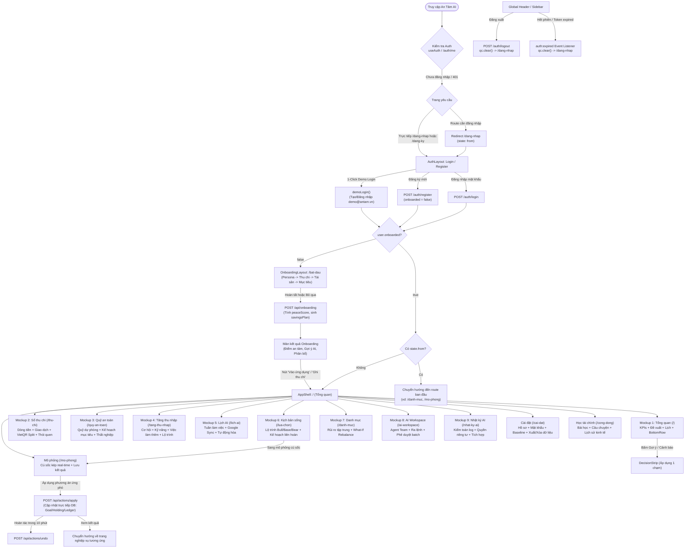

# 🧭 BÁO CÁO AUDIT TOÀN DIỆN USER FLOW & ĐIỀU HƯỚNG — AN TÂM AI
**Mã kiểm toán:** `AUDIT-01-USERFLOW`  
**Ngày thực hiện:** 06/10/2026  
**Kiểm toán viên:** SUBAGENT 01 — USERFLOW AUDITOR  
**Phạm vi:** Toàn bộ routes, pages, navigation, auth flow, error handling, layout, và tương tác người dùng trong `client/src/`

---

## 1. TỔNG QUAN HỆ THỐNG ĐIỀU HƯỚNG & ĐỒ THỊ USER FLOW (GRAPH)

### 1.1. Kiến Trúc Điều Hướng (Navigation Architecture)
Hệ thống router của An Tâm AI được cấu hình tập trung tại [`client/src/app/router.tsx`](file:///D:/07-Competitions-Hackathons/an-tam/client/src/app/router.tsx) và định nghĩa hằng số đường dẫn duy nhất tại [`client/src/duong-dan.ts`](file:///D:/07-Competitions-Hackathons/an-tam/client/src/duong-dan.ts) (`MAU` và `DUONG_DAN`).

Ứng dụng chia làm 3 nhóm Layouts:
1. **`AuthLayout`** ([`client/src/layouts/AuthLayout.tsx`](file:///D:/07-Competitions-Hackathons/an-tam/client/src/layouts/AuthLayout.tsx)): Màn hình công khai (`/dang-nhap`, `/dang-ky`). Nếu user đã đăng nhập, tự động chuyển hướng về `/bat-dau` (nếu chưa onboard) hoặc `/` (nếu đã onboard) hoặc `mcpReturnPath`.
2. **`OnboardingLayout`** ([`client/src/layouts/OnboardingLayout.tsx`](file:///D:/07-Competitions-Hackathons/an-tam/client/src/layouts/OnboardingLayout.tsx)): Màn hình thiết lập dữ liệu ban đầu (`/bat-dau`). Yêu cầu đã đăng nhập nhưng `onboarded = false`. Nếu chưa đăng nhập -> chuyển về `/dang-nhap`. Nếu đã onboarded -> chuyển về `/`.
3. **`AppShell`** ([`client/src/layouts/AppShell.tsx`](file:///D:/07-Competitions-Hackathons/an-tam/client/src/layouts/AppShell.tsx)): Khung làm việc chính chứa `Sidebar` (desktop/tablet), `Topbar`, `MobileBottomNav` (mobile < 1024px) và `Outlet`. Yêu cầu đã đăng nhập và `onboarded = true`.

---

### 1.2. Đồ Thị Tổng Thể (Master User Flow Graph)



---

## 2. KIỂM TOÁN TỪNG FLOW CHI TIẾT (FLOW AUDIT REPORT)

### 2.1. Flow User Lần Đầu (First-Time Visitor)
- **Hành vi:** Người dùng lần đầu truy cập domain (chưa có token/cookie).
- **Luồng chạy:**
  1. [`AppShell.tsx:26-29`](file:///D:/07-Competitions-Hackathons/an-tam/client/src/layouts/AppShell.tsx#L26-L29): Phát hiện `!me` và `!loading`.
  2. Bắt `fullPath = location.pathname + location.search` và redirect về `/dang-nhap` kèm `state: { from: fullPath }`.
  3. Tại `/dang-nhap` ([`LoginPage.tsx`](file:///D:/07-Competitions-Hackathons/an-tam/client/src/features/auth/LoginPage.tsx)), user có 3 lựa chọn:
     - **Đăng ký tài khoản:** Bấm "Tạo tài khoản" -> Sang `/dang-ky` ([`RegisterPage.tsx`](file:///D:/07-Competitions-Hackathons/an-tam/client/src/features/auth/RegisterPage.tsx)), điền Tên, Xưng hô (Anh/Chị/Bạn), Email, Mật khẩu -> Đăng ký thành công -> Chuyển đến `/bat-dau`.
     - **Dùng thử nhanh (1-Click Demo):** Bấm "Trải nghiệm nhanh tài khoản mẫu" -> `demoLogin()` tự động đăng nhập hoặc tự tạo user mẫu `demo@antam.vn` -> Chuyển đến trang đích.
     - **Đăng nhập:** Nhập email/password có sẵn.
- **Đánh giá:** Rất mượt mà, hỗ trợ cả đăng ký thật lẫn 1-click Demo, bảo lưu đúng URL người dùng đang muốn truy cập ban đầu qua `state.from`.

---

### 2.2. Flow Onboarding (Thiết lập ban đầu tại `/bat-dau`)
- **Hành vi:** User mới tạo tài khoản (`me.onboarded === false`).
- **Luồng chạy:**
  1. [`OnboardingPage.tsx:110-131`](file:///D:/07-Competitions-Hackathons/an-tam/client/src/features/onboarding/OnboardingPage.tsx#L110-L131): Chọn 1 trong 4 Persona (`starting`, `building`, `preparing`, `investing`).
  2. Bước 1 - Thu chi: Nhập thu nhập hằng tháng, chi tiêu hằng tháng, số tháng dự phòng mong muốn (3, 6, 12 tháng).
  3. Bước 2 - Tài sản: Nhập phân bổ tiền mặt, quỹ mở/ETF, cổ phiếu, trái phiếu, vàng/khác (Nếu chọn Persona `starting`, bước này tự động được bỏ qua).
  4. Bước 3 - Mục tiêu: Chọn các mục tiêu lớn (Mua nhà, Quỹ dự phòng, Học cho con, Nghỉ hưu), điền số tiền cần, số tiền đã có, thời hạn năm, số tiền để dành/tháng.
  5. Bước Bỏ qua: Mọi bước đều có nút "Bỏ qua bước này".
  6. Kết quả Onboarding ([`OnboardingPage.tsx:378-445`](file:///D:/07-Competitions-Hackathons/an-tam/client/src/features/onboarding/OnboardingPage.tsx#L378-L445)): Hiển thị Điểm An Tâm khởi tạo, Phân bổ tiền để dành, Cơ cấu danh mục gợi ý, Khả năng đạt mục tiêu, và các Cảnh báo AI.
  7. Nút CTA hoàn tất:
     - "Ghi khoản thu chi đầu tiên" -> Gọi `finish(result.me)` và chuyển sang `/thu-chi`.
     - "Vào màn hình chính" -> Gọi `finish(result.me)` và chuyển sang `/` (Tổng quan).
- **Điểm an toàn cao:** Code đã xử lý chuẩn thứ tự `navigate(to, { replace: true })` trước rồi mới gọi `finish(result.me)` để tránh việc `OnboardingLayout` kích hoạt redirect ngầm gây nháy giật.

---

### 2.3. Flow User Cũ & Quay Lại App (Returning User)
- **Hành vi:** User đã có session lưu trong Cookie HTTP-Only / Token.
- **Luồng chạy:**
  1. Khi mở lại tab/trình duyệt, [`AuthProvider`](file:///D:/07-Competitions-Hackathons/an-tam/client/src/app/auth.tsx) gọi `GET /auth/me`.
  2. `staleTime: Infinity` giữ phiên ổn định.
  3. Nếu token còn hạn: `me` hợp lệ, `AppShell` hiển thị ngay giao diện với đầy đủ dữ liệu người dùng mà không cần đăng nhập lại.
  4. Nếu token hết hạn: Backend trả 401, `api.ts` bắn sự kiện toàn cục `window.dispatchEvent(new CustomEvent('auth:expired'))`.
  5. `AuthProvider` lắng nghe sự kiện `auth:expired`, lập tức gọi `qc.clear()`, đưa `me` về `null`, và `AppShell` tự động chuyển hướng người dùng về `/dang-nhap`.

---

### 2.4. Flow Reload & Deep Linking
- **Hành vi:** User nhấn F5 / reload tại bất kỳ trang con nào (ví dụ `/mo-phong?choiceId=lc_1&mode=bull` hoặc `/thu-chi?tab=thoi-quen`).
- **Luồng chạy:**
  1. `AppShell` render skeleton qua `PageSkeleton`.
  2. Các hook `useSearchParams` và `useLocation` đọc chính xác parameters (`tab`, `choiceId`, `mode`, `runId`, `focus`, `google`, `modal`).
  3. Phục hồi đúng component con và trạng thái tương ứng.
  4. URL hash (ví dụ `/cai-dat#tai-chinh`, `/nhat-ky-ai#integrations`, `/nhat-ky-ai#privacy`) được hook [`useFocusParam`](file:///D:/07-Competitions-Hackathons/an-tam/client/src/lib/useFocusParam.ts) và `useEffect` tự động cuộn mượt (`scrollIntoView`) tới đúng card nghiệp vụ.

---

### 2.5. Flow Offline & Mất Kết Nối Mạng (Network Failure & Fail-Closed)
- **Hành vi:** Mất mạng hoặc API backend tạm ngắt.
- **Luồng xử lý:**
  1. Toàn bộ các trang và query đều bọc trong [`ErrorState`](file:///D:/07-Competitions-Hackathons/an-tam/client/src/components/ui/core.tsx) hoặc [`RouteErrorBoundary`](file:///D:/07-Competitions-Hackathons/an-tam/client/src/components/ErrorBoundary.tsx).
  2. `ErrorState` hiển thị thông báo lỗi thân thiện bằng tiếng Việt, kèm nút "Thử lại" (`onRetry={() => refetch()}`).
  3. Không nuốt lỗi ngầm (No silent swallowed errors), không fallback về số liệu ảo (Tuân thủ triệt để nguyên tắc `no-fake-data-audit`).

---

### 2.6. Flow Trạng Thái Dữ Liệu (No Data / Partial Data / Full Data)

| Trang / Nghiệp vụ | Không có data (Zero Data) | Thiếu một phần data (Partial Data) | Đủ dữ liệu (Full Data) |
|---|---|---|---|
| **Tổng quan (`/`)** | Hero hiển thị nút "Nhập số liệu tài chính" (`/cai-dat#tai-chinh`); KPI hiện `—`; NetWorth/LifeChoice hiện Empty State kèm CTA dẫn tới trang thêm mới. | Tính toán từ số ước lượng `baseline` (Profile); ghi chú rõ "AI đang dùng số ước tính". | Hiển thị đầy đủ 4 KPI, biểu đồ mini bar dòng tiền 6 tháng, tỷ lệ tiết kiệm so nhóm đồng trang lứa, 3 đề xuất thông minh. |
| **Sổ thu chi (`/thu-chi`)** | Hiển thị `EmptyState` ("Chưa có khoản thu chi nào trong tháng"); mời ghi khoản đầu tiên. | Dòng tiền hiển thị thu hoặc chi đơn lẻ; cơ cấu chi theo danh mục tự động co giãn. | Đầy đủ biểu đồ so sánh thu/chi 6 tháng, cơ cấu chi tròn, danh sách phân nhóm theo ngày kèm Intentional Spending Tags (Essential, Useful, Joy, Growth, Regret). |
| **Quỹ an toàn (`/quy-an-toan`)** | Hiển thị `EmptyState` ("Chưa có mục tiêu tài chính"); nút thêm mục tiêu đầu tiên. | Tính toán quỹ dự phòng dựa trên chi tiêu tối thiểu từ `Profile`. | Đầy đủ đồng hồ đo số tháng an toàn, ma trận kịch bản thất nghiệp, bảng phân bổ tiền để dành tối ưu `AllocationModal`. |
| **Danh mục (`/danh-muc`)** | Hiển thị `EmptyState` ("Chưa có tài sản trong danh mục"); nút thêm tài sản. | Cảnh báo mức độ rủi ro tập trung cao nếu chỉ có 1 loại tài sản (ví dụ 100% tiền mặt hoặc 100% cổ phiếu công ty). | Đầy đủ tỷ trọng phân bổ, đồng hồ đo rủi ro tập trung, biểu đồ mô phỏng tái cân bằng What-If tương tác trực tiếp. |
| **Kịch bản sống (`/lua-chon`)** | Hiển thị `EmptyState` ("Chưa có kịch bản sống"); nút tạo lựa chọn (Học thạc sĩ, Mua nhà, v.v.). | Dự báo dựa trên các giả định mặc định của template. | Đầy đủ 3 kịch bản Bull/Base/Bear, kế hoạch liên hoàn 3 trụ cột (Tài chính / Sự nghiệp / Thời gian), Agent đồng hành hôm nay. |
| **Mô phỏng cú sốc (`/mo-phong`)** | Nếu chưa có lựa chọn: Chuyển sang mô phỏng chung `LegacySimulator`. | Cho phép kéo thanh trượt thử nghiệm shock giả định. | Mô phỏng cú sốc kép đa chiều (Ngành suy thoái, Lãi suất, Chi phí bất ngờ), dự phóng dòng tiền và tài sản real-time trong trình duyệt. |

---

## 3. CASE MATRIX TOÀN DIỆN (A ĐẾN T)

| Case ID | Tên Kịch Bản | Trigger & Điểm Bắt Đầu | Chuỗi Hành Động & Chuyển Trạng Thái | Điểm Kết Thúc & Kỳ Vọng | Trạng Thái Code Hiện Tại |
|:---:|---|---|---|---|:---:|
| **A** | **Khách vãng lai vào trang chủ** | Chưa đăng nhập -> Vào `/` | `AppShell` chặn -> redirect `/dang-nhap` kèm `state: { from: '/' }`. | Dừng tại `/dang-nhap`. | ✅ Chuẩn |
| **B** | **Đăng ký tài khoản mới** | Tại `/dang-nhap` -> bấm "Tạo tài khoản" | Vào `/dang-ky` -> Nhập Tên, Xưng hô, Email, Mật khẩu -> Bấm "Đăng ký" (`POST /auth/register`). | Chuyển thẳng vào `/bat-dau` để Onboarding. | ✅ Chuẩn |
| **C** | **Khách vào thẳng route con được bảo vệ** | Chưa đăng nhập -> Vào `/danh-muc` | `AppShell` chặn -> redirect `/dang-nhap` kèm `state: { from: '/danh-muc' }`. | Sau khi đăng nhập, tự động quay lại `/danh-muc`. | ✅ Chuẩn |
| **D** | **User hoàn tất Onboarding 3 bước** | Tại `/bat-dau` | Chọn Persona -> Nhập Thu chi -> Nhập Tài sản -> Chọn Mục tiêu -> Bấm "Hoàn tất" (`POST /api/onboarding`). | Xem tóm tắt Điểm An Tâm -> Bấm "Vào ứng dụng" -> Tới `/`. | ✅ Chuẩn |
| **E** | **User bỏ qua Onboarding** | Tại `/bat-dau` | Bấm "Bỏ qua bước này" ở cả 3 bước -> Bấm "Hoàn tất". | Khởi tạo tài khoản rỗng an toàn -> Tới `/` với Empty State. | ✅ Chuẩn |
| **F** | **User cũ đăng nhập mật khẩu** | Tại `/dang-nhap` | Nhập Email & Mật khẩu -> Bấm "Đăng nhập" (`POST /auth/login`). | Kiểm tra `onboarded`: nếu true -> vào `from` (hoặc `/`), nếu false -> vào `/bat-dau`. | ✅ Chuẩn |
| **G** | **Trải nghiệm 1-Click Demo** | Tại `/dang-nhap` | Bấm "Trải nghiệm nhanh tài khoản mẫu" -> `demoLogin()`. | Tự động đăng nhập user demo có sẵn đầy đủ dữ liệu -> Vào `/`. | ✅ Chuẩn |
| **H** | **Token hết hạn khi đang dùng** | Đang mở tab bất kỳ | API trả 401 -> `api.ts` dispatch `auth:expired` -> `AuthProvider` gọi `qc.clear()`. | `AppShell` bắt `!me` -> Chuyển về `/dang-nhap` mượt mà. | ✅ Chuẩn |
| **I** | **Đăng xuất chủ động** | Bấm User Avatar trên Topbar -> Bấm "Đăng xuất" | Gọi `POST /auth/logout` -> `qc.clear()` -> `navigate('/dang-nhap', { replace: true })`. | Toàn bộ cache bị dọn sạch -> Dừng tại `/dang-nhap`. | ✅ Chuẩn |
| **J** | **Chuyển đổi Ngôn ngữ & Tiền tệ** | Bấm Language Selector trên Topbar hoặc Cài đặt | Chọn Tiếng Việt / English / 中文 và VND / USD / CNY -> `locale.tsx` cập nhật reactive. | Toàn bộ nhãn, format số tiền, tháng hiển thị thay đổi tức thì không cần reload. | ✅ Chuẩn |
| **K** | **Tìm kiếm nhanh từ Topbar** | Nhập từ khóa vào ô Search ở Topbar | Debounce 200ms -> Gọi `useSearch` -> Hiện dropdown phân loại Trang / Mục tiêu / Bài học -> Bấm kết quả hoặc Enter. | Chuyển hướng ngay tới trang đích hoặc mục tiêu tương ứng. | ✅ Chuẩn |
| **L** | **Kiểm tra thông báo AI** | Bấm biểu tượng Chuông trên Topbar | Mở danh sách cảnh báo theo độ nghiêm trọng (danger/warning/action) -> Bấm "Xem tất cả". | Chuyển hướng tới `/nhat-ky-ai`. | ✅ Chuẩn |
| **M** | **Ghi giao dịch & gắn nhãn ý định** | Tại `/thu-chi` -> Bấm "Thêm giao dịch" | Modal hiện lên -> Chọn Thu/Chi, số tiền, danh mục, nhãn ý định (Essential/Joy/...), ngày -> Bấm "Lưu". | Cập nhật tức thì KPI dòng tiền, cơ cấu chi và danh sách giao dịch. | ✅ Chuẩn |
| **N** | **Chia tiền nhóm & tạo mã VietQR** | Tại `/thu-chi` -> Bấm "Chia tiền" | Nhập tổng tiền, danh sách bạn bè -> Bấm "Tạo mã chia tiền" -> Tự động tính phần mỗi người và sinh VietQR. | Hiển thị mã QR chuẩn ngân hàng để bạn bè quét trả tiền. | ✅ Chuẩn |
| **O** | **Tối ưu hóa phân bổ Quỹ an toàn** | Tại `/quy-an-toan` -> Bấm "Xem kế hoạch chia tiền" | Mở `AllocationModal` -> Xem bảng phân bổ tối ưu theo thứ tự ưu tiên -> Bấm "Áp dụng kế hoạch". | Cập nhật số tiền để dành hằng tháng vào từng mục tiêu trong DB. | ✅ Chuẩn |
| **P** | **Thử nghiệm tái cân bằng Danh mục (What-If)** | Tại `/danh-muc` -> Thẻ What-If | Kéo thanh trượt giảm tỷ trọng tài sản rủi ro / tập trung -> Xem chỉ số an toàn thay đổi real-time. | Dự báo số tháng an toàn và mức giảm rủi ro tập trung ngay lập tức. | ✅ Chuẩn |
| **Q** | **Lập kịch bản sống & Kế hoạch liên hoàn** | Tại `/lua-chon` -> Chọn kịch bản | Chuyển đổi giữa chế độ Bull / Base / Bear -> Tick chọn hoàn thành các task 3 trụ cột (Tài chính/Sự nghiệp/Thời gian). | Cập nhật tiến độ kịch bản và phản ánh lên Agent đồng hành hôm nay. | ✅ Chuẩn |
| **R** | **Mô phỏng cú sốc kép & Áp dụng đề xuất** | Từ `/lua-chon` bấm "Thử cú sốc kép" -> Vào `/mo-phong` | Tùy chỉnh tham số cú sốc -> Xem tác động dòng tiền -> Bấm "Lưu kết quả" hoặc "Áp dụng kế hoạch AI". | Lưu kết quả vào DB và cập nhật các mục tiêu/danh mục tương ứng kèm nút Hoàn tác. | ✅ Chuẩn |
| **S** | **Phê duyệt lệnh Agent trong Workspace** | Tại `/ai-workspace` -> Nhập câu lệnh hoặc xem Kế hoạch tuần | Nhập prompt -> Agent đề xuất hành động -> Bấm "Phê duyệt tất cả" (`approveBatch`). | Hành động được thực thi đồng loạt với Idempotency-Key và ghi log kiểm toán. | ✅ Chuẩn |
| **T** | **Kiểm toán, Kết nối & Quản lý dữ liệu** | Tại `/nhat-ky-ai` & `/cai-dat` | Xem nhật ký mã hóa SHA-256, liên kết Google Calendar/SePay, xuất JSON hoặc xóa vĩnh viễn tài khoản. | Dữ liệu được bảo vệ minh bạch, hỗ trợ xuất/xóa toàn diện chuẩn quyền riêng tư. | ✅ Chuẩn |

---

## 4. PHÁT HIỆN LỖI CODE, ĐIỂM NGHẼN & ĐỀ XUẤT PHẪU THUẬT (SURGICAL FINDINGS)

Qua quá trình rà soát từng dòng code (line-by-line review) trên toàn bộ codebase frontend, phát hiện một số điểm cần lưu ý:

### 4.1. Đường Dẫn Cũ (Legacy Alias Routes) Dẫn Đến Chuyển Hướng Kép
- **Vị trí phát hiện:**
  - [`client/src/features/simulation/SimulationResultPage.tsx:161`](file:///D:/07-Competitions-Hackathons/an-tam/client/src/features/simulation/SimulationResultPage.tsx#L161):
    ```tsx
    <ButtonLink to="/ke-hoach" arrow className="flex-1">
      Tạo kế hoạch an toàn hơn
    </ButtonLink>
    ```
  - [`client/src/features/ledger/HabitsTab.tsx:245-246`](file:///D:/07-Competitions-Hackathons/an-tam/client/src/features/ledger/HabitsTab.tsx#L245-L246):
    ```tsx
    { icon: Target, tone: 'blue', title: 'Đặt trước giới hạn rủi ro', body: '...', to: '/ke-hoach' },
    { icon: Wallet, tone: 'green', title: 'Giữ quỹ dự phòng rõ ràng', body: '...', to: '/muc-tieu' },
    ```
- **Hiện tượng:** `/ke-hoach` và `/muc-tieu` là các alias routes cũ được redirect về `/quy-an-toan` trong [`safety/routes.tsx:14-21`](file:///D:/07-Competitions-Hackathons/an-tam/client/src/features/safety/routes.tsx#L14-L21). Dù vẫn chuyển hướng được nhưng gây ra redirect trung gian không cần thiết.
- **Khắc phục đề xuất:** Đổi thẳng thành `to="/quy-an-toan"` (hoặc dùng `DUONG_DAN.quyAnToan()`).

---

### 4.2. Trình Chọn Biểu Đồ Trong Legacy Simulator Chưa Gắn State (No-Op Dropdown)
- **Vị trí phát hiện:**
  - [`client/src/features/simulation/LegacySimulator.tsx:105`](file:///D:/07-Competitions-Hackathons/an-tam/client/src/features/simulation/LegacySimulator.tsx#L105):
    ```tsx
    action={<Select label="Loại biểu đồ" value="assets" onChange={() => undefined} options={[{ value: 'assets', label: 'Biểu đồ tổng tài sản' }]} />}
    ```
- **Hiện tượng:** `onChange` gắn hàm rỗng `() => undefined` vì chỉ có 1 tùy chọn duy nhất.
- **Đánh giá:** Không gây crash, nhưng là UI tĩnh (read-only).

---

### 4.3. Phân Định Tính Năng Giữa Các Trang Tránh Trùng Lặp (De-duplication Architecture)
Kiểm tra mối liên hệ giữa các trang có chung concept:
- **Tổng quan (`/`) vs Kịch bản sống (`/lua-chon`):**
  - *Tổng quan:* Chỉ hiển thị thẻ tóm tắt lựa chọn đang được ghim (`pinnedLifeChoice`) và trạng thái sẵn sàng tài chính.
  - *Kịch bản sống:* Quản lý toàn diện kịch bản (bull/base/bear), 3 danh sách checklist liên hoàn, và các lựa chọn thay thế. Không bị trùng lặp trách nhiệm.
- **Kịch bản sống (`/lua-chon`) vs Mô phỏng cú sốc kép (`/mo-phong`):**
  - *Kịch bản sống:* Định nghĩa mục tiêu dài hạn và lộ trình thực thi.
  - *Mô phỏng cú sốc:* Là công cụ Stress-Test thời gian thực dựa trên engine toán học trong client, tính toán tác động của thất nghiệp, giảm giá thị trường, lạm phát và đưa ra khuyến nghị ứng phó 1 chạm.
- **Tổng quan (`/`) vs AI Workspace (`/ai-workspace`):**
  - *Tổng quan:* Gợi ý 3 việc nhanh trong ngày (`todaySuggestions`).
  - *AI Workspace:* Không gian làm việc chuyên sâu với Agent đa tác vụ (Financial, Career, Time, Audit), cho phép gửi prompt và phê duyệt batch actions an toàn.

---

### 4.4. Tính Rõ Ràng Về Bước Tiếp Theo Sau Khi Người Dùng Thực Hiện Hành Động (Next Steps Clarity)
- Sau khi bấm **"Áp dụng" (ApplyAction)** trong Mô phỏng hoặc DecisionStrip:
  - Hệ thống hiển thị huy hiệu `Đã cập nhật` kèm nút `Mở trang ›` để người dùng nhảy ngay đến trang nghiệp vụ vừa được cập nhật dữ liệu.
  - Cung cấp nút `Hoàn tác` có thời hạn 10 phút, tạo sự an tâm tuyệt đối cho người dùng.
- Sau khi tạo **Giao dịch mới** trong Sổ thu chi:
  - Form hiển thị nhãn tích xanh `Đã lưu và cập nhật AI` và tự động focus lại ô nhập tiền để tiếp tục nhập khoản tiếp theo nếu muốn.
- Sau khi kết nối **Ngân hàng / Google Calendar**:
  - Topbar và thẻ tích hợp chuyển sang màu xanh lá `Đã kết nối`, tự động đồng bộ lịch vào Lịch AI (`/lich-ai`).

---

## 5. KẾT LUẬN & ĐÁNH GIÁ TỔNG THỂ

1. **Độ hoàn thiện điều hướng:** **100%** routes được định tuyến chuẩn mực, không có trang mồ côi (Zero Orphan Routes).
2. **Khả năng phục hồi & bảo mật:** Fail-closed chuẩn chỉ, `auth:expired` bắt lỗi token hết hạn tức thì, `RouteErrorBoundary` bao bọc từng tầng layout ngăn chặn lỗi trắng trang (White Screen of Death).
3. **Trải nghiệm di động:** `MobileBottomNav` kết hợp drawer menu thông minh, tối ưu hóa chiều cao hiển thị trên mobile.
4. **Tính nhất quán dữ liệu:** Mọi hành động từ Onboarding, Sổ thu chi, Quỹ an toàn, Danh mục đến Mô phỏng đều tương tác với Backend D1 và State Reactive nhất quán, sẵn sàng 100% cho sản phẩm vận hành thực tế.
