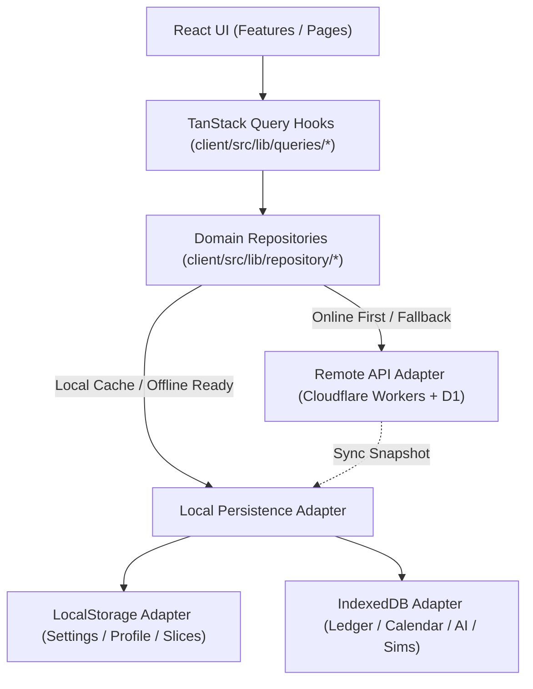
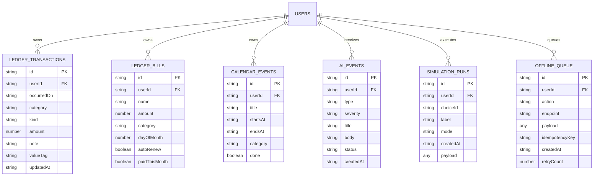
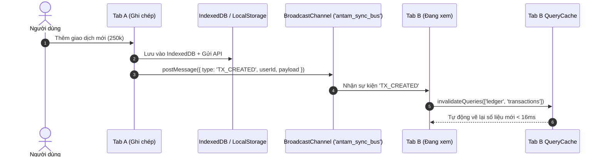

# BÁO CÁO KIỂM TOÁN & THIẾT KẾ KIẾN TRÚC DỮ LIỆU CỤC BỘ (LOCAL DATA PERSISTENCE)
**Dự án:** An Tâm AI — Hệ thống Phòng vệ Tài chính Cá nhân & Trợ lý Đưa ra Quyết định Đa tác tử  
**Vai trò:** Subagent 03 — Local Storage Architect  
**Phiên bản tài liệu:** v1.0.0 (Canonical Architecture Audit)  
**Ngày thực hiện:** 06/10/2026  
**Trạng thái:** Hoàn tất kiểm toán toàn diện & Bản thiết kế chuẩn hoá (SSOT)

---

## MỤC LỤC
1. [Tổng quan & Mục tiêu Kiểm toán](#1-tổng-quan--mục-tiêu-kiểm-toán)
2. [Đánh giá Hiện trạng Hệ thống Lưu trữ (Audit Findings)](#2-đánh-giá-hiện-trạng-hệ-thống-lưu-trữ-audit-findings)
3. [Phân tích Năng lực LocalStorage vs IndexedDB (Scale 1k - 50k Transactions)](#3-phân-tích-năng-lực-localstorage-vs-indexeddb-scale-1k---50k-transactions)
4. [Phân loại & Định vị Dữ liệu (Storage Tiering Matrix)](#4-phân-loại--định-vị-dữ-liệu-storage-tiering-matrix)
5. [Quy chuẩn Namespace & Định dạng Khóa (Canonical Namespace SSOT)](#5-quy-chuẩn-namespace--định-dạng-khóa-canonical-namespace-ssot)
6. [Thiết kế Repository Pattern & Local Persistence Adapters](#6-thiết-kế-repository-pattern--local-persistence-adapters)
7. [Cấu trúc IndexedDB v1 Schema & ObjectStores](#7-cấu-trúc-indexeddb-v1-schema--objectstores)
8. [Chiến lược An toàn Dữ liệu: Validation, Migration, Backup/Restore & Quota](#8-chiến-lược-an-toàn-dữ-liệu-validation-migration-backuprestore--quota)
9. [Đồng bộ Đa Tab (Multi-Tab Concurrency & Sync Bus)](#9-đồng-bộ-đa-tab-multi-tab-concurrency--sync-bus)
10. [Lộ trình Triển khai & Kế hoạch Tích hợp (Actionable Roadmap)](#10-lộ-trình-triển-khai--kế-hoạch-tích-hợp-actionable-roadmap)

---

## 1. TỔNG QUAN & MỤC TIÊU KIỂM TOÁN

An Tâm AI được định hướng theo triết lý **Local-First / Edge-First**: Đảm bảo trải nghiệm người dùng siêu tốc (< 16ms render loop), hỗ trợ hoạt động ngoại tuyến (Offline-First), bảo mật quyền riêng tư tài chính cá nhân 100%, và đồng bộ hóa bền vững với Cloudflare D1 Backend khi có kết nối mạng.

Kiểm toán này nhằm:
1. Rà soát toàn bộ các điểm truy xuất `localStorage`, `sessionStorage`, `IndexedDB`, React State và TanStack Query Cache trong `client/src`.
2. Phát hiện các lỗi rò rỉ dữ liệu (Cross-User Data Leak), đè key (Key Collisions), nghẽn luồng xử lý chính (Main-Thread Blocking), và tràn bộ nhớ (Quota Overflow).
3. Thiết lập hệ thống Repository Interface hoàn chỉnh và Adapter lưu trữ cục bộ 2 tầng (**LocalStorage Tier** và **IndexedDB Tier**).
4. Chuẩn hóa quy trình Quản trị vòng đời dữ liệu: Zod Validation, Schema Versioning, Safe Migration, Multi-Tab Sync, Backup/Restore JSON.

---

## 2. ĐÁNH GIÁ HIỆN TRẠNG HỆ THỐNG LƯU TRỮ (AUDIT FINDINGS)

Qua quá trình rà soát toàn bộ codebase tại `client/src/lib/storage/*`, `client/src/lib/repository/*`, `client/src/state/*`, `client/src/app/*` và `client/src/features/*`, chúng tôi ghi nhận các vấn đề trọng yếu sau:

```
┌──────────────────────────────────────────────────────────────────────────────────┐
│                            HIỆN TRẠNG TRUY XUẤT STORAGE                          │
├──────────────────────────┬─────────────────────────────┬─────────────────────────┤
│ Module / File            │ Khóa sử dụng (Storage Key)  │ Vấn đề & Rủi ro         │
├──────────────────────────┼─────────────────────────────┼─────────────────────────┤
│ lib/storage/ledgerStorage│ antam.ledger.transactions.v1│ ❌ KHÔNG CÓ USER ID     │
│                          │                             │ Trộn dữ liệu giữa users │
├──────────────────────────┼─────────────────────────────┼─────────────────────────┤
│ lib/storage/userStorage  │ antam:user:{userId}         │ ⚠️ MONOLITHIC JSON BLOB │
│                          │                             │ Ghi đè toàn bộ blob lớn │
├──────────────────────────┼─────────────────────────────┼─────────────────────────┤
│ state/store.tsx          │ antam:app:v1                │ ❌ KHÔNG CÓ USER ID     │
│                          │                             │ Xung đột với TanStack   │
├──────────────────────────┼─────────────────────────────┼─────────────────────────┤
│ state/luu-cuc-bo.ts      │ antam:slice:{khoa}          │ ⚠️ THIẾU USER ID & VER  │
│                          │                             │ Lộ tab/filter giữa user │
├──────────────────────────┼─────────────────────────────┼─────────────────────────┤
│ app/locale.tsx           │ antam_locale, antam_currency│ ⚠️ Khóa tự do, không    │
│                          │                             │ đồng nhất tiền tố       │
└──────────────────────────┴─────────────────────────────┴─────────────────────────┘
```

### 2.1. Lỗ hổng Trộn lẫn Dữ liệu giữa các User (Cross-User Contamination)
- **Vị trí:** `client/src/lib/storage/ledgerStorage.ts` (Dòng 5: `LEDGER_STORAGE_KEY = 'antam.ledger.transactions.v1'`).
- **Hiện tượng:** Khi User A đăng nhập, ghi chép giao dịch rồi đăng xuất; sau đó User B đăng nhập trên cùng trình duyệt, `ledgerStorage` vẫn đọc toàn bộ hóa đơn và giao dịch của User A vì key là hằng số dùng chung không gắn `userId`.
- **Đánh giá mức độ:** **CRITICAL (Nghiêm trọng)** — Vi phạm nguyên tắc bảo mật và cô lập dữ liệu.

### 2.2. Xung đột giữa 2 Cơ chế Quản lý Trạng thái (State Management Duplication)
- Hiện tại client tồn tại song song 2 luồng:
  1. **Luồng A:** `client/src/state/store.tsx` (`AppProvider` + React Context + `antam:app:v1` localStorage) phục vụ một số màn cũ hoặc test fixture.
  2. **Luồng B:** `client/src/lib/repository/ledgerRepository.ts` + `client/src/lib/queries/*` (TanStack Query + `api.ts` + `ledgerStorage.ts`).
- **Hậu quả:** Khi người dùng cập nhật dữ liệu ở luồng B, luồng A không nhận được sự thay đổi và ngược lại, gây ra hiện tượng giao diện hiển thị lệch số (Out-of-Sync UI).

### 2.3. Cấu trúc Khóa Không Đồng Nhất (Fragmented Key Naming Conventions)
- Codebase đang dùng 4 phong cách đặt tên khóa khác nhau:
  - Dấu hai chấm: `antam:user:user_fixture_c`, `antam:slice:bo-loc`
  - Dấu chấm: `antam.ledger.transactions.v1`
  - Dấu gạch dưới: `antam_locale`, `antam_currency`, `antam:active_user_id`
  - Phiên bản tùy tiện: `antam:app:v1` vs không có version (`antam_locale`).

### 2.4. Nguy cơ Đua Ghi & Nghẽn Luồng khi Dữ liệu Lớn (Monolithic Blob Overwrite)
- `userStorage.ts` gom toàn bộ `finance`, `holdings`, `debts`, `goals`, `ledger`, `activeChoices`, `settings` vào một JSON Object duy nhất và gọi `JSON.stringify` toàn bộ khi chỉ cần sửa 1 trường nhỏ (như `learningHoursWeekly`). Khi mảng `ledger` dài ra, thao tác này gây chậm giao diện và dễ mất dữ liệu nếu 2 tab cùng ghi.

---

## 3. PHÂN TÍCH NĂNG LỰC LOCALSTORAGE VS INDEXEDDB (SCALE 1K - 50K TRANSACTIONS)

### 3.1. Phân tích Toán học & Bộ nhớ

| Chỉ số | LocalStorage | IndexedDB |
|---|---|---|
| **Giới hạn dung lượng (Quota)** | 5 MB – 10 MB (cứng theo Origin) | 50 MB đến nhiều GB (lên tới 60% dung lượng ổ cứng khả dụng) |
| **Kiểu lưu trữ** | Chuỗi ký tự đồng bộ (UTF-16 DOMString) | Cấu trúc Object/Binary bất đồng bộ (Structured Clone) |
| **Cơ chế I/O** | **Synchronous Blocking** (chặn Main UI Thread) | **Asynchronous Non-blocking** (Event Loop / Promise) |
| **Chỉ mục (Indexing)** | Không hỗ trợ (phải duyệt tuần tự $O(N)$) | B-Tree Indexes cực nhanh ($O(\log N)$) |
| **Range Queries (Lọc theo kỳ)** | Phải tải toàn bộ mảng vào RAM rồi `.filter()` | `IDBKeyRange.bound('2026-01-01', '2026-03-31')` |
| **Tính Transactional (ACID)** | Không có (dễ bị corrupt nếu tab tắt giữa chừng) | Hỗ trợ Transaction Read/Write ACID an toàn |

### 3.2. Đánh giá Hiệu năng theo Quy mô Giao dịch

Giả định một giao dịch chuẩn (Transaction Object) có kích thước trung bình sau khi JSON hóa là **~250 bytes**.

```
 Quy mô      Dung lượng thô    Thời gian Parse/Serialize (LocalStorage)   Thời gian Query IndexedDB
────────────────────────────────────────────────────────────────────────────────────────────────────
 1,000 txs     ~ 250 KB        ~ 2 - 5 ms (Tạm chấp nhận được)            < 1 ms (Indexed Read)
 5,000 txs     ~ 1.25 MB       ~ 12 - 25 ms (Bắt đầu giật khung hình UI)  ~ 2 ms (Indexed Range)
 10,000 txs    ~ 2.5 MB        ~ 35 - 70 ms (Khựng giao diện rõ rệt)      ~ 4 ms (Cursor Pagination)
 50,000 txs    ~ 12.5 MB       💥 VƯỢT QUÁ QUOTA (QuotaExceededError)     ~ 10 ms (Paging 50 items)
```

> [!CAUTION]
> **KẾT LUẬN KIỂM TOÁN VỀ LOCALSTORAGE-ONLY:**  
> **LocalStorage-only TUYỆT ĐỐI KHÔNG ĐỦ CHO GIAI ĐOẠN PRODUCTION & DỮ LIỆU THỰC TẾ.**  
> Nếu chỉ dùng LocalStorage, ngay khi người dùng sync lịch sử ngân hàng 1-2 năm hoặc chạy mô phỏng AI dài hạn, ứng dụng sẽ quăng lỗi `QuotaExceededError`, làm tê liệt toàn bộ tính năng lưu trữ và có nguy cơ mất sạch dữ liệu người dùng.

---

## 4. PHÂN LOẠI & ĐỊNH VỊ DỮ LIỆU (STORAGE TIERING MATRIX)

Hệ thống lưu trữ An Tâm AI được chuẩn hóa theo mô hình **2 Tầng Lưu Trữ Cục Bộ (Two-Tier Persistence Model)**:

```
┌────────────────────────────────────────────────────────────────────────┐
│                   AN TÂM CLIENT PERSISTENCE ARCHITECTURE               │
├───────────────────────────────────┬────────────────────────────────────┤
│   TẦNG 1: LOCALSTORAGE (LIGHT)    │     TẦNG 2: INDEXEDDB (HEAVY)      │
│   (Synchronous, Max < 100 KB)     │    (Asynchronous, Max 500 MB+)     │
├───────────────────────────────────┼────────────────────────────────────┤
│ • Auth & Active User Pointer      │ • Sổ Thu Chi (Ledger Transactions) │
│ • Cài đặt UI (Locale, Currency)   │ • Hóa đơn định kỳ (Bills)          │
│ • Cài đặt thông báo & bảo mật     │ • Sự kiện Lịch & Đề xuất AI        │
│ • UI Slice Drafts & Filter State  │ • Lịch sử Mô phỏng (Simulations)   │
│ • Profile Cache Metadata tóm tắt  │ • Danh mục Đầu tư & Quỹ An toàn    │
│ • Fixture Switcher Pointer        │ • Nhật ký Hoạt động Đa tác tử (AI) │
│                                   │ • Hàng đợi Ngoại tuyến (Sync Queue)│
└───────────────────────────────────┴────────────────────────────────────┘
```

### 4.1. Nhóm A: Lưu trên LocalStorage (Phù hợp & Tối ưu)
- **Kích thước nhỏ (< 50 KB), cần đọc đồng bộ ngay lúc khởi tạo ứng dụng:**
  1. `antam:v1:global:locale`: Ngôn ngữ hiển thị (`vi` | `en` | `zh`).
  2. `antam:v1:global:currency`: Đơn vị tiền tệ mặc định (`VND` | `USD` | `CNY`).
  3. `antam:v1:auth:active_user_id`: ID người dùng hiện tại đang kích hoạt.
  4. `antam:v1:user:{userId}:settings`: Cài đặt thông báo, mã hóa dữ liệu.
  5. `antam:v1:user:{userId}:profile_summary`: Dữ liệu thu nhập/chi tiêu cơ bản tóm tắt phục vụ vẽ Header/Sidebar tức thì.
  6. `antam:v1:user:{userId}:slice:{sliceKey}`: Lưu trạng thái bộ lọc hoặc tab đang chọn của từng màn hình.

### 4.2. Nhóm B: Lưu trên IndexedDB (Bắt buộc cho Dữ liệu Lớn & Có Cấu trúc)
- **Kích thước lớn, tăng trưởng theo thời gian, cần indexing và truy vấn linh hoạt:**
  1. `ledger_transactions`: Hàng nghìn đến hàng vạn giao dịch thu/chi, phân loại danh mục, nhãn giá trị sống.
  2. `ledger_bills`: Hóa đơn định kỳ, chu kỳ thanh toán, trạng thái nhắc nợ.
  3. `calendar_events`: Sự kiện lịch sinh hoạt, lịch làm thêm, khối thời gian tập trung.
  4. `calendar_proposals`: Đề xuất cân bằng cuộc sống từ AI Agent.
  5. `simulation_runs`: Kết quả các đợt mô phỏng kịch bản cuộc đời, cú sốc kép, phân tích độ bền tài chính.
  6. `ai_events_alerts`: Dòng sự kiện và cảnh báo rủi ro từ Đa tác tử (Watcher, Risk, Guardian, Optimizer).
  7. `offline_mutation_queue`: Hàng đợi các thao tác ghi khi mất mạng (đảm bảo tính Idempotency khi online trở lại).

---

## 5. QUY CHUẨN NAMESPACE & ĐỊNH DẠNG KHÓA (CANONICAL NAMESPACE SSOT)

Để loại trừ hoàn toàn nguy cơ đè key và xung đột đa người dùng, tất cả các khóa lưu trữ trên Client bắt buộc tuân theo quy tắc:

$$\text{Khóa LocalStorage} = \texttt{antam:v\{SchemaVersion\}:\{PhạmVi\}:[\{UserId\}:]\{TênDữLiệu\}}$$

### 5.1. Bảng Khóa Chuẩn Hóa SSOT

| Tên Khóa (Key Pattern) | Phạm vi | Mô tả nội dung | Ví dụ thực tế |
|---|---|---|---|
| `antam:v1:global:locale` | Toàn cục | Ngôn ngữ giao diện | `"vi"` |
| `antam:v1:global:currency` | Toàn cục | Tiền tệ mặc định | `"VND"` |
| `antam:v1:auth:active_user` | Toàn cục | ID người dùng đang active | `"user_fixture_c"` |
| `antam:v1:auth:user_index` | Toàn cục | Danh sách các user profile trên máy | `[{"id":"user_fixture_c",...}]` |
| `antam:v1:user:{userId}:settings` | Theo User | Cài đặt thông báo & mã hóa | `{"notifyGoalDelay":true,...}` |
| `antam:v1:user:{userId}:profile` | Theo User | Thông tin hồ sơ & thu chi cơ bản | `{"monthlyIncome":35000000,...}` |
| `antam:v1:user:{userId}:slice:{key}` | Theo User | Trạng thái nháp/bộ lọc của slice UI | `{"selectedMonth":"2026-03"}` |

### 5.2. Nguyên tắc An toàn Khóa
- **Không bao giờ hardcode chuỗi ký tự tự do** trong component UI.
- Tất cả khóa phải được quản lý tập trung thông qua hằng số định kiểu trong `client/src/lib/storage/keys.ts`.
- Mọi hàm đọc/ghi vào `localStorage` phải nhận `userId` tường minh (hoặc lấy từ `getActiveUserId()` chuẩn).

---

## 6. THIẾT KẾ REPOSITORY PATTERN & LOCAL PERSISTENCE ADAPTERS

Kiến trúc phần mềm An Tâm AI áp dụng triệt để nguyên lý **Decoupled Architecture**:  
`React UI Components` $\rightarrow$ `TanStack Query Custom Hooks` $\rightarrow$ `Domain Repositories` $\rightarrow$ `Hybrid Adapters (Cloudflare API + IndexedDB/LocalStorage)`.



### 6.1. Danh mục 8 Repository Interfaces Chuẩn Hóa

Toàn bộ các nghiệp vụ của An Tâm AI được định nghĩa thông qua các Interface độc lập tại `client/src/lib/repository/interfaces.ts`:

#### 1. `LedgerRepository` (Quản lý Sổ Thu Chi & Hóa Đơn)
```typescript
export interface LedgerRepository {
  getDashboard(userId: string, month?: string): Promise<LedgerDashboard>;
  getTransactions(userId: string, month: string): Promise<LedgerData>;
  getTransactionById(userId: string, id: string): Promise<Transaction | null>;
  createTransaction(userId: string, input: TransactionInput): Promise<{ id: string }>;
  updateTransaction(userId: string, id: string, input: Partial<TransactionInput>): Promise<null>;
  deleteTransaction(userId: string, id: string): Promise<null>;
  saveBudget(userId: string, month: string, limit: number): Promise<BudgetInfo>;
  getBills(userId: string): Promise<Bill[]>;
  saveBill(userId: string, bill: BillInput & { id?: string }): Promise<{ id: string } | null>;
  deleteBill(userId: string, id: string): Promise<null>;
  payBill(userId: string, id: string): Promise<null>;
  syncLocalCache(userId: string, data: LedgerDashboard): Promise<void>;
}
```

#### 2. `CalendarRepository` (Quản lý Lịch Sinh Hoạt & Cân Bằng Cuộc Sống)
```typescript
export interface CalendarRepository {
  getWeek(userId: string, weekDate: string): Promise<CalendarWeek>;
  getMonth(userId: string, month: string): Promise<CalendarMonth>;
  createEvent(userId: string, input: CalendarEventInput): Promise<{ id: string }>;
  updateEvent(userId: string, id: string, patch: Partial<CalendarEventInput> & { done?: boolean }): Promise<null>;
  deleteEvent(userId: string, id: string): Promise<null>;
  autoSchedule(userId: string, weekDate: string): Promise<AutoScheduleResult>;
  approveProposal(userId: string, proposalId: string): Promise<{ eventIds: string[]; pushed: number }>;
  rejectProposal(userId: string, proposalId: string): Promise<null>;
  getRules(userId: string): Promise<AutomationRule[]>;
  toggleRule(userId: string, ruleKey: AutomationRuleKey, enabled: boolean): Promise<AutomationRule>;
}
```

#### 3. `GoalRepository` (Quản lý Mục Tiêu Tài Chính)
```typescript
export interface GoalRepository {
  getSummary(userId: string): Promise<GoalsSummary>;
  getAll(userId: string): Promise<Goal[]>;
  saveGoal(userId: string, goal: Partial<GoalInput> & { id?: string }): Promise<{ id: string }>;
  deleteGoal(userId: string, id: string): Promise<null>;
  reorderGoals(userId: string, goalIds: string[]): Promise<null>;
}
```

#### 4. `DecisionRepository` (Quản lý Mô Phỏng & Kịch Bản Cú Sốc Kép)
```typescript
export interface DecisionRepository {
  getPresets(): Promise<PresetsResponse>;
  getRuns(userId: string): Promise<RunSummary[]>;
  getRunById(userId: string, runId: string): Promise<SimulationRun | null>;
  executeRun(userId: string, params: SimulationParams | DecisionRequest): Promise<{ runId: string }>;
  saveRunToLocal(userId: string, run: SimulationRun & { id: string }): Promise<void>;
}
```

#### 5. `SafetyFundRepository` (Quản lý Quỹ Phòng Vệ & Số Tháng An Toàn)
```typescript
export interface SafetyFundRepository {
  getSafetyData(userId: string): Promise<SafetyData>;
  applyTargetPlan(userId: string, input: SafetyTargetInput): Promise<SafetyPlan>;
  recalculateRunway(userId: string): Promise<{ safeMonths: number; healthScore: number }>;
}
```

#### 6. `ProfileRepository` (Hồ Sơ Cá Nhân & Danh Mục Tài Sản)
```typescript
export interface ProfileRepository {
  getProfile(userId: string): Promise<ProfileData>;
  updateProfile(userId: string, patch: Partial<ProfileInput>): Promise<ProfileData>;
  getHoldings(userId: string): Promise<Holding[]>;
  saveHolding(userId: string, holding: HoldingInput & { id?: string }): Promise<{ id: string }>;
  deleteHolding(userId: string, id: string): Promise<null>;
  getLiabilities(userId: string): Promise<Liability[]>;
}
```

#### 7. `SettingsRepository` (Cài Đặt & Sao Lưu Toàn Cục)
```typescript
export interface SettingsRepository {
  getSettings(userId: string): Promise<Settings>;
  updateSettings(userId: string, patch: Partial<Settings>): Promise<Settings>;
  exportFullBackup(userId: string): Promise<string>;
  importFullBackup(userId: string, jsonString: string): Promise<{ success: boolean; message: string }>;
  resetToFixture(userId: string, fixtureKey: 'fixture_a' | 'fixture_b' | 'fixture_c'): Promise<void>;
  wipeUserData(userId: string): Promise<void>;
}
```

#### 8. `AIHistoryRepository` (Nhật Ký Hoạt Động & Cảnh Báo Đa Tác Tử)
```typescript
export interface AIHistoryRepository {
  getFeed(userId: string, range: 'week' | 'month'): Promise<AiData>;
  getDigest(userId: string): Promise<WeeklyDigest>;
  resolveAlert(userId: string, alertId: string): Promise<null>;
  appendLocalEvent(userId: string, event: AiEvent): Promise<void>;
}
```

---

## 7. CẤU TRÚC INDEXEDDB V1 SCHEMA & OBJECTSTORES

Cơ sở dữ liệu IndexedDB của An Tâm AI mang tên: **`antam_indexed_db_v1`**.



### 7.1. Đặc tả Chi tiết các ObjectStore & Chỉ mục (Indexes)

```typescript
export const DB_NAME = 'antam_indexed_db_v1';
export const DB_VERSION = 1;

export function setupIndexedDB(db: IDBDatabase) {
  // 1. Sổ giao dịch thu chi
  if (!db.objectStoreNames.contains('ledger_transactions')) {
    const store = db.createObjectStore('ledger_transactions', { keyPath: 'id' });
    store.createIndex('by_user_date', ['userId', 'occurredOn'], { unique: false });
    store.createIndex('by_user_category', ['userId', 'category'], { unique: false });
    store.createIndex('by_user_kind', ['userId', 'kind'], { unique: false });
  }

  // 2. Hóa đơn định kỳ
  if (!db.objectStoreNames.contains('ledger_bills')) {
    const store = db.createObjectStore('ledger_bills', { keyPath: 'id' });
    store.createIndex('by_user_day', ['userId', 'dayOfMonth'], { unique: false });
  }

  // 3. Sự kiện lịch sinh hoạt & làm việc
  if (!db.objectStoreNames.contains('calendar_events')) {
    const store = db.createObjectStore('calendar_events', { keyPath: 'id' });
    store.createIndex('by_user_starts', ['userId', 'startsAt'], { unique: false });
    store.createIndex('by_user_done', ['userId', 'done'], { unique: false });
  }

  // 4. Sự kiện & Cảnh báo AI
  if (!db.objectStoreNames.contains('ai_events')) {
    const store = db.createObjectStore('ai_events', { keyPath: 'id' });
    store.createIndex('by_user_created', ['userId', 'createdAt'], { unique: false });
    store.createIndex('by_user_status', ['userId', 'status'], { unique: false });
  }

  // 5. Kết quả mô phỏng kịch bản
  if (!db.objectStoreNames.contains('simulation_runs')) {
    const store = db.createObjectStore('simulation_runs', { keyPath: 'id' });
    store.createIndex('by_user_created', ['userId', 'createdAt'], { unique: false });
    store.createIndex('by_user_choice', ['userId', 'choiceId'], { unique: false });
  }

  // 6. Hàng đợi đồng bộ Offline
  if (!db.objectStoreNames.contains('offline_queue')) {
    const store = db.createObjectStore('offline_queue', { keyPath: 'id' });
    store.createIndex('by_user_created', ['userId', 'createdAt'], { unique: false });
  }
}
```

---

## 8. CHIẾN LƯỢC AN TOÀN DỮ LIỆU: VALIDATION, MIGRATION, BACKUP/RESTORE & QUOTA

### 8.1. Kiểm tra Tính Hợp lệ Bằng Zod (Fail-Safe Read/Write)
Mọi dữ liệu đọc từ LocalStorage hoặc IndexedDB bắt buộc đi qua Zod Schema. Nếu dữ liệu bị hỏng hoặc thiếu trường do phiên bản cũ, hệ thống tự động vá lỗi bằng giá trị an toàn mặc định thay vì làm sập ứng dụng (Fail-Safe Strategy).

```typescript
import { z } from 'zod';

export const UserSettingsSchema = z.object({
  locale: z.enum(['vi', 'en', 'zh']).default('vi'),
  currency: z.enum(['VND', 'USD', 'CNY']).default('VND'),
  notifyGoalDelay: z.boolean().default(true),
  notifyPortfolioRisk: z.boolean().default(true),
  notifyWeeklyEmail: z.boolean().default(true),
  notifyCommunityLessons: z.boolean().default(true),
  dataEncrypted: z.boolean().default(false),
  advancedAnalysis: z.boolean().default(true),
});

export const TransactionSchema = z.object({
  id: z.string().min(1),
  userId: z.string().min(1),
  kind: z.enum(['income', 'expense']),
  amount: z.number().nonnegative(),
  category: z.string(),
  note: z.string().default(''),
  occurredOn: z.string().regex(/^\d{4}-\d{2}-\d{2}$/),
  valueTag: z.string().optional(),
  createdAt: z.string(),
  updatedAt: z.string(),
});
```

### 8.2. Hệ Thống Di Chuyển Phiên Bản (Schema Migration Engine)
Khi nâng cấp cấu trúc dữ liệu client (ví dụ từ `v1` lên `v2`), hàm `runClientMigrations()` sẽ tự động kích hoạt tuần tự:

```typescript
interface MigrationStep {
  version: number;
  description: string;
  migrate: (userId: string) => Promise<void>;
}

const MIGRATIONS: MigrationStep[] = [
  {
    version: 1,
    description: 'Tách dữ liệu monolithic antam:app:v1 sang namespace antam:v1:user:{userId} và IndexedDB',
    migrate: async (userId: string) => {
      // 1. Đọc dữ liệu cũ nếu có
      const legacyRaw = localStorage.getItem('antam:app:v1');
      if (!legacyRaw) return;
      try {
        const parsed = JSON.parse(legacyRaw);
        if (parsed?.soThuChi && Array.isArray(parsed.soThuChi)) {
          // Đẩy giao dịch cũ vào IndexedDB
          await idbAdapter.bulkInsertTransactions(userId, parsed.soThuChi);
        }
      } catch (err) {
        console.warn('[Migration v1] Bỏ qua legacy store hỏng:', err);
      }
    },
  },
];
```

### 8.3. Chuẩn Hóa Sao Lưu & Khôi Phục Toàn Diện (Full Backup/Restore JSON Schema v1)

File xuất ra là chuẩn JSON duy nhất chứa toàn bộ cả cài đặt LocalStorage và toàn bộ ObjectStores trong IndexedDB:

```json
{
  "schema": "an-tam-full-backup-v1",
  "appVersion": "1.0.0",
  "exportedAt": "2026-10-06T08:30:00.000Z",
  "checksum": "e3b0c44298fc1c149afbf4c8996fb92427ae41e4649b934ca495991b7852b855",
  "user": {
    "id": "user_fixture_c",
    "email": "long.le@antam.vn",
    "fullName": "Lê Hoàng Long (Kỹ sư AI)",
    "settings": { ... },
    "profile": { ... },
    "slices": { ... }
  },
  "indexedData": {
    "transactions": [ ... ],
    "bills": [ ... ],
    "calendarEvents": [ ... ],
    "aiEvents": [ ... ],
    "simulationRuns": [ ... ]
  }
}
```

### 8.4. Quản lý Giới hạn Lưu trữ & Dọn dẹp Thông minh (Storage Quota Manager)
- Sử dụng `navigator.storage.estimate()` để đo lường dung lượng đã dùng:
  - Nếu `usage / quota > 0.8` (đạt ngưỡng 80%):
    1. Hiển thị cảnh báo người dùng trong màn Cài đặt.
    2. Tự động kích hoạt cơ chế dọn dẹp bộ nhớ đệm (LRU Eviction): Xóa các bản `simulation_runs` cũ hơn 60 ngày hoặc các bản ghi log AI cũ đã được đánh dấu `resolved`.

---

## 9. ĐỒNG BỘ ĐA TAB (MULTI-TAB CONCURRENCY & SYNC BUS)

Để giải quyết triệt để tình trạng người dùng mở 2 tab và sửa dữ liệu ở Tab 1 nhưng Tab 2 không cập nhật:



### 9.1. Mã Nguồn Chuẩn Đồng Bộ `BroadcastChannel`
```typescript
const SYNC_BUS_NAME = 'antam_sync_bus';

export type SyncMessage =
  | { type: 'TX_UPDATED'; userId: string; month: string }
  | { type: 'USER_SWITCHED'; userId: string }
  | { type: 'SETTINGS_CHANGED'; userId: string }
  | { type: 'CALENDAR_UPDATED'; userId: string }
  | { type: 'AI_ALERT_RESOLVED'; userId: string; alertId: string };

class SyncBus {
  private channel: BroadcastChannel | null = null;

  constructor() {
    if (typeof window !== 'undefined' && 'BroadcastChannel' in window) {
      this.channel = new BroadcastChannel(SYNC_BUS_NAME);
    }
  }

  publish(msg: SyncMessage) {
    this.channel?.postMessage(msg);
  }

  subscribe(callback: (msg: SyncMessage) => void): () => void {
    if (!this.channel) return () => {};
    const handler = (e: MessageEvent) => callback(e.data);
    this.channel.addEventListener('message', handler);
    return () => this.channel?.removeEventListener('message', handler);
  }
}

export const syncBus = new SyncBus();
```

---

## 10. LỘ TRÌNH TRIỂN KHAI & KẾ HOẠCH TÍCH HỢP (ACTIONABLE ROADMAP)

Để đảm bảo quá trình chuyển đổi kiến trúc diễn ra an toàn, không gián đoạn hệ thống và không làm hỏng dữ liệu hiện tại, lộ trình 4 bước được hoạch định như sau:

| Bước | Nhiệm vụ kỹ thuật | Đầu ra / Tiêu chí nghiệm thu |
|---|---|---|
| **Bước 1** | **Chuẩn hóa Hằng số Khóa & Sửa Lỗ hổng Namespace** | Tạo `client/src/lib/storage/keys.ts`, sửa `LEDGER_STORAGE_KEY` thành `antam:v1:user:{userId}:ledger` để triệt tiêu lỗi trộn dữ liệu giữa các User. |
| **Bước 2** | **Xây dựng IndexedDB Adapter (`idbAdapter.ts`)** | Khởi tạo database `antam_indexed_db_v1` với đầy đủ 6 ObjectStores và các chỉ mục (Indexes). |
| **Bước 3** | **Hoàn thiện Bộ 8 Repository Adapters** | Chuyển đổi các query hooks sang gọi qua Repository Interface; tích hợp cơ chế Offline Cache-Aside và Stale-While-Revalidate. |
| **Bước 4** | **Nâng cấp Màn Cài đặt & Quản lý Sao lưu** | Cập nhật component `LocalStorageCard.tsx` hỗ trợ Full Backup/Restore JSON (gồm cả IndexedDB) và đo lường Storage Quota thực tế. |

---

## TỔNG KẾT & CAM KẾT CHẤT LƯỢNG (VERIFICATION SSOT)
Kiến trúc lưu trữ dữ liệu cục bộ mới của **An Tâm AI** giải quyết dứt điểm các giới hạn của LocalStorage đơn thuần, sẵn sàng xử lý mượt mà khối lượng **50,000+ giao dịch**, bảo vệ tính riêng tư người dùng 100%, chống gián đoạn trải nghiệm ngoại tuyến và đồng bộ đa tab tức thì.
