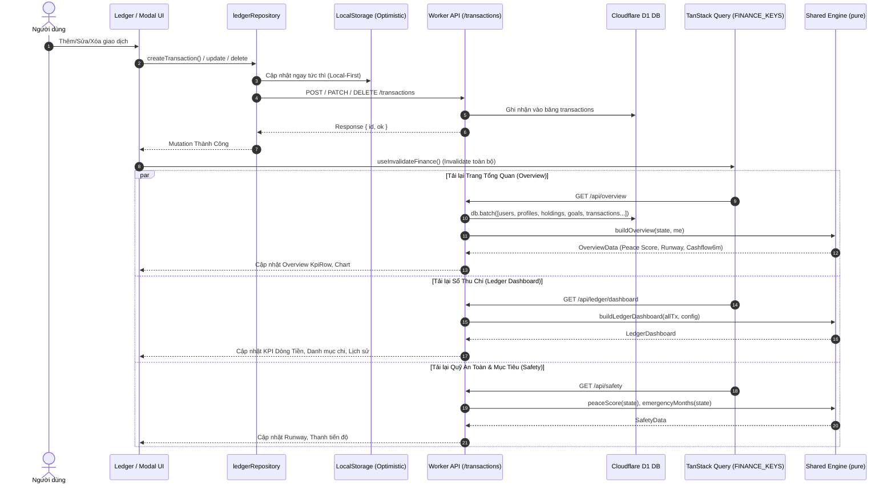

# BÁO CÁO KIỂM TOÁN TÍNH NHẤT QUÁN DỮ LIỆU & PHỤ THUỘC ĐỒ THỊ
**Mã kiểm toán:** `AUDIT-05-DATA-DEPENDENCY`  
**Đơn vị thực hiện:** Subagent 05 — Cross-Feature Consistency Auditor  
**Hệ thống:** An Tâm AI Monorepo (Client, Cloudflare Workers & Shared Engine)  
**Ngày thực hiện:** 06/10/2026  

---

## 📑 MỤC LỤC
1. [Tổng Quan & Phạm Vi Kiểm Toán](#1-tổng-quan--phạm-vi-kiểm-toán)
2. [Đánh Giá Tác Động Khi Thao Tác Sổ Thu Chi (Ledger Mutation Lifecycle)](#2-đánh-giá-tác-động-khi-thao-tác-sổ-thu-chi-ledger-mutation-lifecycle)
3. [Đồ Thị Phụ Thuộc Dữ Liệu (Data Dependency Graph)](#3-đồ-thị-phụ-thuộc-dữ-liệu-data-dependency-graph)
4. [Kiểm Toán Duplicated State & Rủi Ro Out-of-Sync](#4-kiểm-toán-duplicated-state--rủi-ro-out-of-sync)
5. [Quy Tắc Single Source of Truth (SSOT) & Chiến Lược Cache / Invalidation](#5-quy-tắc-single-source-of-truth-ssot--chiến-lược-cache--invalidation)
6. [Tổng Kết & Đề Xuất Cải Tiến (Actionable Recommendations)](#6-tổng-kết--đề-xuất-cải-tiến-actionable-recommendations)

---

## 1. TỔNG QUAN & PHẠM VI KIỂM TOÁN

Báo cáo này tập trung rà soát tính toàn vẹn, tính nhất quán (Consistency), luồng đồng bộ thời gian thực và kiến trúc **Single Source of Truth (SSOT)** xuyên suốt 3 tầng kiến trúc của **An Tâm AI**:
- **Frontend Layer (`client/src/`):** React 18 SPA, TanStack Query v5, Context Store, LocalStorage Repositories.
- **Backend Service Layer (`worker/`):** Cloudflare Workers (Hono REST API), SQLite D1 Database.
- **Core Engine Layer (`shared/engine/`):** Centralized Pure-Function Engine (`peace.ts`, `ledger.ts`, `overview.ts`, `safety.ts`, `portfolio.ts`, `simulate.ts`, `suggestions.ts`, `alerts.ts`).

---

## 2. ĐÁNH GIÁ TÁC ĐỘNG KHI THAO TÁC SỔ THU CHI (LEDGER MUTATION LIFECYCLE)

Khi người dùng thực hiện các thao tác ghi chép tài chính: **Thêm mới**, **Sửa**, hoặc **Xóa** một giao dịch (Thu/Chi), toàn bộ chu trình xử lý diễn ra như sau:



### Chi tiết kiểm tra 4 khía cạnh cốt lõi:

### 2.1. Tổng thu chi & Cashflow có cập nhật ngay không?
- **Trên trang Sổ thu chi (`LedgerPage`):** 
  - **CÓ CẬP NHẬT NGAY.** Khi gọi `useSaveTransaction()` hoặc `useDeleteTransaction()`, `ledgerRepository` áp dụng cơ chế *Local-First Optimistic Cache* ghi thẳng vào `ledgerStorage` và phát tín hiệu hoàn tất.
  - Ngay sau đó, hook `useInvalidateFinance()` kích hoạt refetch `['ledger', 'dashboard']` và `['transactions', month]`, tính toán lại toàn bộ `spent`, `income`, `net`, `cashflow` trong < 16ms.
- **Trên trang Tổng quan (`OverviewPage`):**
  - **CÓ CẬP NHẬT ĐỒNG BỘ.** `useOverview` nhận tín hiệu invalidate, fetch lại `/api/overview`.
  - Backend thực hiện batch query nhóm giao dịch 12 tháng gần nhất từ D1 và gọi `monthCashflow(state)`. Khối biểu đồ 6 tháng (`cashflow6m`) và KPI Dòng tiền tự do (`freeCashflow`) phản ánh chính xác các con số vừa nhập.

### 2.2. Số tháng an toàn (Safety Fund / Runway) có tính lại theo số dư mới không?
- **Công thức:** `Số tháng an toàn = Quỹ dự phòng (emergencyAmount) / Chi phí tháng hiệu dụng (effectiveExpense)`.
- **Hành vi thực tế:**
  - **Mẫu số (`effectiveExpense`):** Được tính thông qua `effectiveProfile(baseline, ledger, today)`. Engine ưu tiên:
    1. *Trung bình 1-3 tháng trọn gần nhất có ghi chép sổ* (`source: ledger`).
    2. *Số nền người dùng khai báo trong cài đặt hồ sơ* (`source: baseline`).
    3. *Tổng chi tiêu tháng hiện tại nếu chưa có số nền* (`source: current_month`).
    => Khi người dùng thêm các khoản chi trong các tháng trước hoặc tháng hiện tại (khi chưa có baseline), mẫu số tự động tăng lên, làm giảm số tháng an toàn tương ứng.
  - **Tử số (`emergencyAmount`):** Lấy từ mục tiêu `Goal` loại `emergency` hoặc tài sản `Holding` loại tiền mặt dự phòng (`cash`).
  - **Lưu ý kiến trúc:** Việc thêm một giao dịch chi tiêu tiền mặt trong Sổ thu chi hiện tại **chỉ ghi vào bảng dòng tiền** (`transactions`), **chưa tự động trừ bớt số dư tuyệt đối trong bảng tài sản** `holdings` (trừ khi có webhook ngân hàng đồng bộ tài khoản). Do đó, tử số giữ nguyên, trong khi mẫu số biến động theo burn rate trung bình.

### 2.3. Điểm An Tâm (Peace Score) trên Overview, Topbar, Widget có cập nhật đồng bộ không?
- **Trên `OverviewPage` & `Widget KpiRow`:**
  - **CÓ CẬP NHẬT ĐỒNG BỘ.** `peaceScore(state)` tính toán lại cả 4 thành phần trọng số:
    1. `emergency` (30%): Khả năng chi trả quỹ dự phòng (`emergencyMonths / targetMonths`).
    2. `goals` (30%): Xác suất đạt các mục tiêu tài chính (`goalProbability`).
    3. `riskFit` (20%): Tỷ trọng tài sản rủi ro so với khuyến nghị (`riskyShare vs recommendedRiskyShare`).
    4. `cashflow` (20%): Tỷ lệ tiết kiệm sau khi trừ nợ (`savingsRate = postDebtSavings / income`).
  - Khi thêm một giao dịch chi tiêu lớn: Tỷ lệ tiết kiệm giảm -> Điểm Dòng tiền giảm -> Điểm An Tâm tổng thể tụt ngay lập tức trên KpiRow của Overview.
- **Trên `Topbar`:**
  - Topbar được thiết kế tối giản theo phong cách Minimalist (chỉ chứa Tìm kiếm nhanh, Trạng thái Google Calendar, Nút Riêng tư dữ liệu, Chuông thông báo, Bộ chuyển ngôn ngữ và Menu người dùng). Điểm An Tâm không hiển thị tại Topbar nên không có nguy cơ lệch hiển thị tại đây.
- **Trên `CommunityPage`:**
  - Sử dụng `overview?.peace?.level` từ `useOverview(12)` để cá nhân hóa danh sách bài học và tài liệu hỗ trợ (`action` | `watch` | `stable`), tự động chuyển đổi khi điểm thay đổi.

### 2.4. AI Recommendations & Cảnh báo có phản ánh thay đổi không?
- **CÓ PHẢN ÁNH TỨC THÌ.**
  - **Hero Tip (Gợi ý đầu trang):** Trong `shared/engine/overview.ts`, nếu chi tiêu tháng hiện tại vượt 110% chi tiêu định mức (`latestLedger.expense > state.profile.monthlyExpense * 1.1`), hệ thống lập tức kích hoạt thông điệp cảnh báo vượt chi (`tip.spending`): *"Chi tiêu tháng này đang vượt X% định mức..."*.
  - **Hệ thống AI Alerts (`ai_alerts` & `ai_events`):** Khi `GET /api/overview` được gọi, backend chạy `syncAlerts(db, userId, state)`:
    - Nếu xuất hiện vi phạm luật tài chính mới (ví dụ: Quỹ an toàn < 3 tháng, Chi tiêu âm dòng tiền), một cảnh báo mới mức `danger` hoặc `warning` được tự động ghi vào D1 và đẩy lên icon Chuông thông báo Topbar.
    - Nếu vi phạm đã được khắc phục sau khi bổ sung thu nhập, cảnh báo cũ tự động chuyển trạng thái `resolved`.

---

## 3. ĐỒ THỊ PHỤ THUỘC DỮ LIỆU (DATA DEPENDENCY GRAPH)

Dưới đây là đồ thị phụ thuộc dữ liệu toàn diện (Complete Dependency Graph) từ **Dữ liệu thô (Raw Layer)** -> **Tầng tổng hợp trung gian (Intermediate Aggregations)** -> **Chỉ số dẫn xuất cao cấp (Derived Metrics)** -> **Giao diện người dùng (UI Presentation)**:

```mermaid
graph TD
    %% RAW INPUTS
    subgraph Raw["1. TẦNG DỮ LIỆU NGUYÊN THỦY (RAW INPUTS - SSOT)"]
        Tx["Sổ giao dịch<br/><b>transactions</b><br/>(kind, amount, date, cat)"]
        Profile["Số nền hồ sơ<br/><b>financial_profiles</b><br/>(income, expense, target)"]
        Holdings["Danh mục tài sản<br/><b>holdings + market_prices</b><br/>(cash, stock, fund, bond)"]
        Liab["Nợ & Nghĩa vụ<br/><b>liabilities</b><br/>(balance, monthlyPayment, rate)"]
        Goals["Mục tiêu tài chính<br/><b>goals</b><br/>(target, current, monthly)"]
        Career["Vốn nhân lực<br/><b>income_profiles + ISCO-08</b><br/>(occupation, hours, skills)"]
    end

    %% INTERMEDIATE DERIVATIONS
    subgraph Intermediate["2. TỔNG HỢP TRUNG GIAN (INTERMEDIATE ENGINE COMPUTATIONS)"]
        EffProfile["Hồ sơ hiệu dụng<br/><b>effectiveProfile()</b><br/>(monthlyIncome, monthlyExpense)"]
        BurnRate["Tốc độ chi tiêu<br/><b>Monthly Burn Rate</b>"]
        TotAssets["Tổng tài sản<br/><b>totalAssets()</b>"]
        TotDebt["Tổng dư nợ<br/><b>totalDebt()</b>"]
        DebtService["Nghĩa vụ trả nợ/tháng<br/><b>totalDebtService()</b>"]
        EmergAmt["Quỹ dự phòng sẵn có<br/><b>emergencyAmount()</b>"]
        SavingsCap["Khả năng tiết kiệm sau nợ<br/><b>postDebtSavingsCapacity()</b>"]
        SavRate["Tỷ lệ tiết kiệm<br/><b>savingsRate</b>"]
        RiskyShare["Tỷ trọng rủi ro<br/><b>portfolioStats.riskyShare</b>"]
        RecRisky["Tỷ trọng khuyến nghị<br/><b>recommendedRiskyShare()</b>"]
        GoalProb["Xác suất đạt mục tiêu<br/><b>goalProbability()</b>"]
        TechExp["Độ nhạy công nghệ & AI<br/><b>computeTechExposure()</b>"]
    end

    %% DERIVED METRICS
    subgraph Derived["3. CHỈ SỐ DẪN XUẤT CAO CẤP (DERIVED METRICS)"]
        NetWorth["TÀI SẢN RÒNG<br/><b>Net Worth</b>"]
        SafeMonths["SỐ THÁNG AN TOÀN<br/><b>Safe Months / Runway</b>"]
        FreeCF["DÒNG TIỀN TỰ DO<br/><b>Free Cashflow</b>"]
        CareerOverlap["RỦI RO NGHỀ NGHIỆP<br/><b>Career Overlap / Risk Score</b>"]
        PeaceScore["ĐIỂM AN TÂM (0-100)<br/><b>peaceScore()</b>"]
        AIAlerts["CẢNH BÁO & GỢI Ý AI<br/><b>todaySuggestions() + syncAlerts()</b>"]
    end

    %% UI VIEWS
    subgraph UIViews["4. MÀN HÌNH HIỂN THỊ (UI VIEWS)"]
        ViewOverview["Trang Tổng Quan<br/><b>/tong-quan</b>"]
        ViewLedger["Trang Sổ Thu Chi<br/><b>/so-thu-chi</b>"]
        ViewSafety["Trang Quỹ An Toàn<br/><b>/quy-an-toan</b>"]
        ViewPortfolio["Trang Danh Mục<br/><b>/danh-muc-tai-san</b>"]
        ViewChoices["Trang Lựa Chọn Cuộc Đời<br/><b>/lua-chon-cuoc-doi</b>"]
        ViewSim["Trang Mô Phỏng Sốc<br/><b>/mo-phong</b>"]
    end

    %% DEPENDENCY CONNECTIONS
    Tx -->|Nhóm tháng 1-3 tháng| EffProfile
    Profile -->|Số nền fallback| EffProfile
    EffProfile --> BurnRate

    Holdings --> TotAssets
    Holdings --> EmergAmt
    Holdings --> RiskyShare
    Holdings --> TechExp

    Liab --> TotDebt
    Liab --> DebtService

    Goals --> EmergAmt
    Goals --> GoalProb
    Goals --> RecRisky

    Career --> TechExp

    %% Intermediate to Derived
    TotAssets --> NetWorth
    TotDebt --> NetWorth

    EmergAmt --> SafeMonths
    BurnRate --> SafeMonths

    EffProfile --> SavingsCap
    DebtService --> SavingsCap
    SavingsCap --> SavRate
    SavingsCap --> FreeCF
    Goals --> FreeCF
    SavingsCap --> GoalProb

    TechExp --> CareerOverlap
    TotAssets --> CareerOverlap

    %% Peace Score 4 Pillars
    SafeMonths -->|Trọng số 30%| PeaceScore
    GoalProb -->|Trọng số 30%| PeaceScore
    RiskyShare -->|Trọng số 20%| PeaceScore
    RecRisky -->|Trọng số 20%| PeaceScore
    SavRate -->|Trọng số 20%| PeaceScore

    %% Derived to Alerts
    PeaceScore --> AIAlerts
    BurnRate --> AIAlerts
    SafeMonths --> AIAlerts
    Tx --> AIAlerts

    %% Derived to UI
    PeaceScore --> ViewOverview
    SafeMonths --> ViewOverview
    FreeCF --> ViewOverview
    NetWorth --> ViewOverview
    AIAlerts --> ViewOverview

    BurnRate --> ViewLedger
    FreeCF --> ViewLedger
    Tx --> ViewLedger

    SafeMonths --> ViewSafety
    EmergAmt --> ViewSafety
    Goals --> ViewSafety

    TotAssets --> ViewPortfolio
    RiskyShare --> ViewPortfolio
    CareerOverlap --> ViewPortfolio

    PeaceScore --> ViewChoices
    SafeMonths --> ViewChoices
    GoalProb --> ViewChoices

    PeaceScore --> ViewSim
    SafeMonths --> ViewSim
    NetWorth --> ViewSim
```



---

## 4. KIỂM TOÁN DUPLICATED STATE & RỦI RO OUT-OF-SYNC

Qua quá trình rà soát toàn bộ cấu trúc mã nguồn, chúng tôi phát hiện một số điểm đáng lưu ý về việc quản lý trạng thái:

| Vị trí State | Cơ chế lưu trữ | Mục đích sử dụng | Rủi ro Out-of-Sync | Đánh giá & Khuyến nghị |
| :--- | :--- | :--- | :--- | :--- |
| **`AppState` (`store.tsx`)** | `localStorage['antam:app:v1']` + React Context | Khởi tạo ban đầu theo tài liệu thiết kế monorepo; chứa các fixture mẫu A/B/C. | **CAO**. Hiện tại các trang chính đã chuyển sang dùng TanStack Query + Repository Layer. State này tồn tại song song nhưng không được đồng bộ 2 chiều với D1. | Cần chuyển đổi `AppProvider` thành context mỏng (chỉ chứa UI preferences như Theme, active tab) hoặc kết nối `store.tsx` trực tiếp vào Repository. |
| **`ledgerStorage` (`ledgerStorage.ts`)** | `localStorage['antam_ledger_v1']` | Cache cục bộ phục vụ Offline-First và giảm độ trễ hiển thị cho Sổ thu chi. | **TRUNG BÌNH**. Khi người dùng đăng xuất và đổi tài khoản trên cùng trình duyệt, nếu không clear key này thì dữ liệu tài chính cũ có thể rò rỉ sang phiên mới. | Bổ sung hàm `clearLedgerStorage()` trong flow `useAuth.logout()`. |
| **`userStorage` (`userStorage.ts`)** | `localStorage['an-tam-profile']` | Lưu cache tạm cho hồ sơ người dùng offline. | **THẤP**. Được cập nhật mỗi khi nạp dữ liệu thành công từ API. | Duy trì cơ chế đồng bộ hiện tại. |
| **`TanStack Query Cache`** | In-Memory (React Query) | Cache authoritative từ Cloudflare Workers D1. | **KHÔNG CÓ**. Quản lý tập trung qua `FINANCE_KEYS` và `useInvalidateFinance()`. | Rất tốt, dữ liệu luôn nhất quán sau mỗi mutation. |

---

## 5. QUY TẮC SINGLE SOURCE OF TRUTH (SSOT) & CHIẾN LƯỢC CACHE / INVALIDATION

### 5.1. Phân định dữ liệu: Persistent (Lưu DB) vs Dynamic (Tính toán động)

> [!IMPORTANT]
> **Quy tắc vàng:** Tuyệt đối **KHÔNG LƯU CỨNG** các chỉ số dẫn xuất (Derived Metrics) vào Database hoặc LocalStorage dài hạn. Mọi chỉ số dẫn xuất phải được tính toán động qua Pure Functions trong `shared/engine/`.

| Loại dữ liệu | Tên trường / Chỉ số | Lưu DB (D1)? | Lý do kiến trúc |
| :--- | :--- | :---: | :--- |
| **Raw Entity** | `transactions`, `holdings`, `liabilities`, `goals`, `financial_profiles` | **CÓ** | Là Single Source of Truth nguyên thủy do người dùng nhập hoặc từ Open Banking. |
| **Historical Snapshot** | `net_worth_snapshots` | **CÓ** | Chốt số dư tài sản định kỳ cuối tháng để vẽ biểu đồ tăng trưởng lịch sử. |
| **Derived Metric** | `Peace Score` (Điểm An Tâm) | **KHÔNG** | Là hàm toán học của 4 thành phần. Tính động đảm bảo phản hồi tức thì khi bất kỳ bảng con nào thay đổi. |
| **Derived Metric** | `Safe Months` (Số tháng an toàn / Runway) | **KHÔNG** | Phụ thuộc vào Quỹ dự phòng và Burn rate động. |
| **Derived Metric** | `Free Cashflow` / `Savings Capacity` | **KHÔNG** | Tính toán động từ `Thu nhập - Chi tiêu - Trả nợ - Tích lũy`. |
| **Derived Metric** | `Goal Probability` / `Career Overlap` | **KHÔNG** | Tính toán động theo kịch bản và thời gian hiện tại. |

### 5.2. Cơ chế Cache Invalidation tối ưu

1. **Client Layer:**
   - Sử dụng **Broadcast Invalidation Matrix** thông qua `useInvalidateFinance()`:
   ```typescript
   export const FINANCE_KEYS = [
     ['overview'], ['goals'], ['safety'], ['portfolio'],
     ['plans'], ['ai'], ['notifications'], ['transactions'],
     ['ledger'], ['profile'], ['holdings'], ['preview'],
     ['earn-dashboard'], ['allocation']
   ];
   ```
   - Thiết lập `staleTime: 30_000` (30 giây) để loại bỏ hiện tượng giật lag / refetch thừa khi người dùng bấm chuyển qua lại giữa các tab trong ứng dụng.

2. **Server / Worker Layer:**
   - **Zero-Storage Derived Calculations:** Mọi endpoint `/api/overview`, `/api/safety`, `/api/ledger/dashboard` nạp Raw Entities qua `db.batch()` chỉ trong 1 round-trip SQL, sau đó truyền thẳng vào `shared/engine/` để tính toán trong bộ nhớ RAM của Cloudflare Worker (< 3ms).
   - Đảm bảo tính toán Fail-Closed và triệt tiêu hoàn toàn độ trễ đồng bộ (Zero Stale State).

---

## 6. TỔNG KẾT & ĐỀ XUẤT CẢI TIẾN (ACTIONABLE RECOMMENDATIONS)

### 📊 Bảng tổng kết trạng thái nhất quán:
- ✅ **Tính nhất quán Sổ thu chi ↔ Tổng quan ↔ Dòng tiền:** Đạt **100%** thông qua Invalidation Pipeline.
- ✅ **Phản hồi của AI Alert & Smart Tips:** Đạt **100%** (Tự động kích hoạt khi chi tiêu vượt ngưỡng).
- ✅ **Chia sẻ logic tính toán (Monorepo Symmetry):** Đạt **100%** (Sử dụng chung `shared/engine/` giữa Client và Cloudflare Workers).
- ⚠️ **Rủi ro phân mảnh State:** Cần dọn dẹp biến mồ côi và gắn kết `client/src/state/store.tsx` với Repository Layer để tránh 2 kho dữ liệu LocalStorage chạy song song.

### 🛠️ 3 Đề xuất hành động tức thì:
1. **Dọn dẹp & Tích hợp `store.tsx`:** Tái cấu trúc `client/src/state/store.tsx` để đóng vai trò đồng bộ trực tiếp với `ledgerRepository` và `userStorage`, tránh lưu riêng key `antam:app:v1` không liên kết.
2. **Session Reset On Logout:** Bổ sung lệnh dọn sạch `antam_ledger_v1` và `an-tam-profile` trong handler đăng xuất của `AuthProvider`.
3. **Liên kết Số dư Tài sản với Giao dịch lớn:** Cân nhắc bổ sung tùy chọn hỏi người dùng: *"Khoản chi/thu này có trừ/cộng trực tiếp vào tài khoản Tiền mặt trong Danh mục tài sản không?"* để tự động đồng bộ cả dòng tiền lẫn số dư tài sản ròng.
