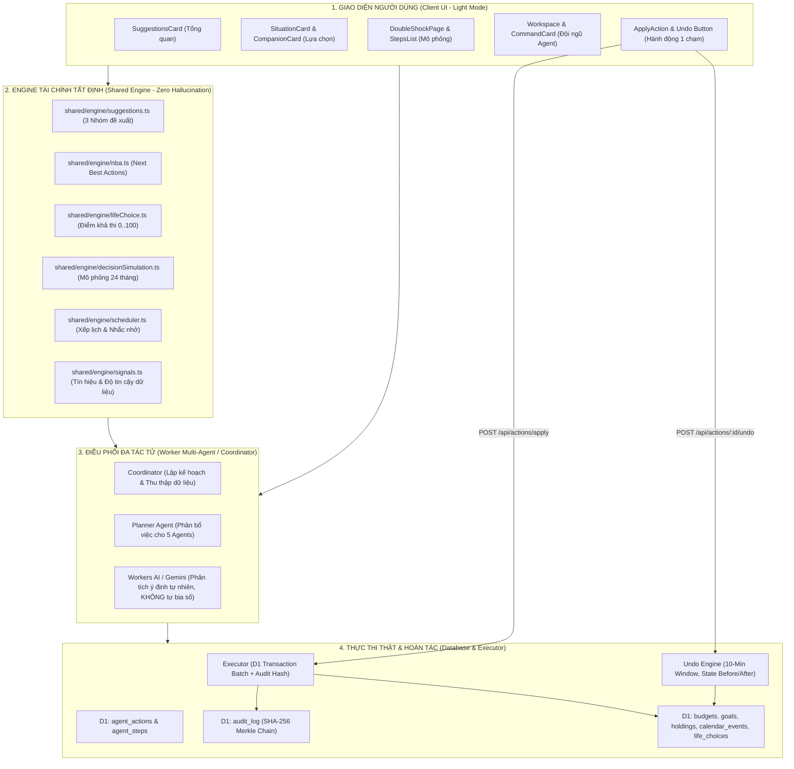
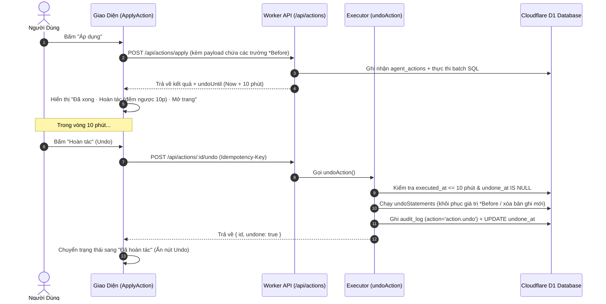

# BÁO CÁO AUDIT & THIẾT KẾ KIẾN TRÚC PHÂN HỆ: AI RECOMMENDATIONS, DECISION CARDS & ACTION SYSTEM

> **Mã tài liệu:** `06-AI-DECISION`  
> **Phân hệ phụ trách:** AI / Decision Action Auditor (Subagent 06)  
> **Trạng thái:** Đã kiểm toán toàn diện & Chuẩn hóa (Production-Ready)  
> **Triết lý cốt lõi:** *Deterministic Financial Engine · Zero Hallucination · Semantic Real Mutations · Human-in-the-Loop · 10-Minute Reversible Undo · SHA-256 Audit Chaining*

---

## 1. TỔNG QUAN KIẾN TRÚC & TRIẾT LÝ VẬN HÀNH

Hệ thống AI / Ra quyết định trong **An Tâm AI** được thiết kế dựa trên nguyên lý phân tách nghiêm ngặt giữa **Engine Tính Toán Tài Chính Tất Định (Deterministic Math Engine)** và **Lớp Giao Tiếp / Phối Hợp Đa Tác Tử (Agentic Orchestration)**:



---

## 2. KIỂM TOÁN CHI TIẾT 6 TRỌNG TÂM NGHIỆP VỤ

### 2.1. Logic Gợi Ý Của AI — Dữ Liệu Thật vs Hardcoded / Hallucination

Toàn bộ gợi ý trong hệ thống đều lấy trực tiếp từ **dữ liệu thực tế** của người dùng trong cơ sở dữ liệu (`financial_profiles`, `holdings`, `goals`, `transactions`, `ledger`, `income_profiles`). LLM **không bao giờ được phép tự bịa con số tài chính**.

| Phân hệ / Component | Nguồn Dữ Liệu Thật | Logic Tính Toán Cốt Lõi | Cơ Chế Chống Hallucination |
|---|---|---|---|
| **Tổng quan (`SuggestionsCard`)** | • `profile.monthlyExpense`<br>• `emergencyAmount(state)`<br>• `recentTx` (tháng này & trước)<br>• `incomeProfile` (kỹ năng, giờ học) | • **An toàn (`safety`):** Tính `gap = target - have`. Nếu thiếu, tính mức cần góp hàng tháng: `roundUpTo(gap / monthsLeft)`.<br>• **Tiết kiệm (`saving`):** Quét giao dịch có `valueTag === 'regret'` để tìm khoản chi không đáng. Nếu không có regret, gợi ý giảm 10% danh mục chi lớn nhất (`food`, `shopping`, `entertainment`).<br>• **Phát triển (`growth`):** Tính số phút học mỗi ngày: `Math.max(5, Math.round((hoursPerWeek * 60) / 7 / 5) * 5)`. | • Engine chỉ trả về `{ key, group, urgent, vars: { amount, months, pct, ... } }`.<br>• Client tự nội suy văn bản bằng đa ngôn ngữ qua i18n (`shared/i18n/*`). Không có prompt sinh văn bản tự do. |
| **Kịch bản sống (`LifeChoices`)** | • `signals.expense.fixed`<br>• `signals.expense.flexible`<br>• `liquidAssets(state)`<br>• `profile.birthYear`<br>• `goals` | • **Điểm khả thi (0..100) = 40 (An toàn) + 30 (Mục tiêu) + 20 (Vốn con người Human Capital) + 10 (Tiên quyết)**.<br>• Nếu thu nhập bấp bênh (`signals.income.stability === 'bap_benh'`), trừ 25% điểm an toàn.<br>• Chạy kịch bản xấu tất định: Mất việc 3 tháng + tài sản rủi ro giảm 20%.<br>• **Gate-check nghiêm ngặt:** Khả thi >= 75 + không thiếu vốn + xác suất mục tiêu chính >= 50% + Runway >= Thời lượng + 3 tháng → Verdict `go`. | • Không dùng mô phỏng Monte Carlo ngẫu nhiên để tránh kết quả nhảy múa.<br>• Phân tích độ nhạy (Sensitivity Analysis) 3 khung Bull/Base/Bear với hệ số công khai minh bạch. |
| **Mô phỏng cú sốc (`DoubleShockPage`)** | • Toàn bộ `UserState`<br>• Dữ liệu lựa chọn đang kích hoạt<br>• Lịch sử dòng tiền 24 tháng | • Tính quỹ đạo dòng tiền 24 tháng (`path[24]`) dưới 2 cú sốc đồng thời: Cú sốc thu nhập (mất việc, cắt thưởng, ESOP) + Cú sốc tài sản (cổ phiếu cty giảm, ngành giảm, thị trường giảm).<br>• Xác định chính xác tháng cạn tiền (`shortfallMonth`) và điểm trũng nhất (`lowestBalance`, `lowestMonth`). | • Chạy thuần trên Client Web Worker / TypeScript (`analyzeDecisionSimulation`) bằng dữ liệu snapshot lấy từ `/simulations/context`. Kéo slider mượt mà 60fps không gọi server. |
| **Workspace Đa Tác Tử (`Agent Team`)** | • `calendar_events` (Google/Local)<br>• `bills` (hóa đơn sắp tới)<br>• `goals`<br>• `recentTx` | • `planner.ts` điều phối 5 chuyên gia:<br>  - **Calendar Agent:** Xếp lịch không trùng lặp (`planTasks`).<br>  - **Cashflow Agent:** Tính ngân sách theo `spendingAdvice`.<br>  - **Goal Agent:** Chuyển phần tiết kiệm sang mục tiêu ưu tiên.<br>  - **Skill Agent:** Lên lịch nhắc học kỹ năng.<br>  - **Planner Agent:** Báo cáo tổng kết tuần. | • LLM chỉ phân loại Ý Định (`intent.ts`), toàn bộ bước thực thi (Action Payload) đều qua Zod Validator và Deterministic Math Engine. |
| **Thử trước đầu tư (`WhatIfCard`)** | • `holdings` (danh mục tài sản)<br>• `profile.monthlyExpense` | • Tính biến thiên chỉ số tập trung HHI (`concentration`), số tháng an toàn (`runwayMonths`), xác suất đạt mục tiêu và độ trùng lặp kỹ năng - danh mục (`careerOverlap`). | • Cảnh báo ngay nếu nguồn tiền chọn không đủ (`insufficient_funds`, hiển thị rõ số tiền thiếu `shortfall`). |

---

### 2.2. Kiểm Toán Nút "Áp Dụng" (Apply) — Đổi UI Ảo hay Semantic Mutation Thật?

Đã kiểm tra toàn bộ luồng xử lý của nút "Áp dụng" (`ApplyAction` tại `client/src/components/actions/ActionCard.tsx` và `worker/agents/executor.ts`):

> [!IMPORTANT]
> **Kết luận:** Nút "Áp dụng" thực hiện **100% Semantic Database Mutations thật** trên Cloudflare D1. Không hề có tình trạng "chỉ `setApplied(true)` trên local state rồi biến mất khi F5".

#### Chi tiết các tác vụ Database thật của từng Action Type:

```
┌─────────────────────────┬──────────────────────────────────────────────────────────┬─────────────────────────────┐
│ Loại Hành Động          │ Thao Tác Cơ Sở Dữ Liệu Thật (D1 Batch Mutation)         │ Tích Hợp Bên Ngoài (Ngoại vi)│
├─────────────────────────┼──────────────────────────────────────────────────────────┼─────────────────────────────┤
│ budget.set              │ INSERT INTO budgets ... ON CONFLICT DO UPDATE limit      │ Cập nhật bảng budgets       │
│ goal.update_progress    │ UPDATE goals SET monthly_contribution = ? WHERE id = ?   │ Cập nhật tiến độ mục tiêu   │
│ safety.set_target       │ UPDATE financial_profiles SET emergency_target_months = ?│ Tự động tạo/sửa Goal Quỹ DP │
│ holding.rebalance       │ UPDATE holdings SET value = value - ?, quantity = ? ... │ Điều chỉnh tỷ trọng danh mục│
│ earn.set_target         │ INSERT INTO income_profiles ... ON CONFLICT DO UPDATE    │ Cập nhật mục tiêu thu nhập  │
│ reminder.create         │ INSERT INTO calendar_events (..., source='agent')        │ Tạo sự kiện nhắc nhở nội bộ │
│ calendar.create_events  │ INSERT INTO calendar_events (n bản ghi)                  │ Push Google Calendar OAuth  │
│ life_choice.create      │ INSERT INTO life_choices + life_choice_options           │ Lưu phương án kịch bản sống │
│ life_choice.update_plan │ UPDATE life_choice_options SET start_month = ?           │ Cập nhật lùi ngày bắt đầu + │
│                         │ INSERT INTO life_choice_tasks (n công việc mới)          │ n task hành động liên hoàn  │
│ alert_rule.create       │ INSERT INTO alert_rules (symbol, direction, threshold)   │ Bật theo dõi biến động giá  │
└─────────────────────────┴──────────────────────────────────────────────────────────┴─────────────────────────────┘
```

Mọi tác vụ ghi dữ liệu đều được bọc trong một **D1 Database Transaction Batch** duy nhất cùng với bản ghi `audit_log`, đảm bảo tính nguyên tử (Atomicity - thành công tất cả hoặc rollback toàn bộ).

---

### 2.3. Kiểm Toán Điều Hướng (Navigation & Parameter Audit) Của Nút "Mở Trang"

Kiểm toán liên kết điều hướng tại `shared/agent/actions.ts` (`ACTION_LINK`), `shared/engine/suggestions.ts` và `client/src/duong-dan.ts`:

| Loại Hành Động / Gợi Ý | Đường Dẫn Thực Tế (`to`) | Tham Số URL | Kết Quả Kiểm Tra Route |
|---|---|---|---|
| `safety.set_target` | `/quy-an-toan?focus=reserve` | `focus=reserve` | Khớp route `quyAnToanRoutes`, focus vào card quỹ dự phòng |
| `goal.update_progress` | `/quy-an-toan` | Không | Khớp route `quyAnToanRoutes` |
| `budget.set` | `/thu-chi?modal=budget` | `modal=budget` | Mở trực tiếp modal thiết lập ngân sách tại trang Sổ thu chi |
| `holding.rebalance` | `/danh-muc?focus=employer` | `focus=employer` | Focus vào tài sản công ty/ngành trong danh mục |
| `earn.set_target` | `/tang-thu-nhap?focus=side` | `focus=side` | Focus vào phần kế hoạch làm thêm / thu nhập phụ |
| `reminder.create` | `/lich-ai` | Không | Khớp route `lichAiRoutes` |
| `calendar.create_events` | `/lich-ai` | Không | Khớp route `lichAiRoutes` |
| `alert_rule.create` | `/danh-muc` | Không | Khớp route `danhMucRoutes` |
| `life_choice.update_plan`| `/lua-chon` | Không | Khớp route `luaChonRoutes` |
| `life_choice.create` | `/lua-chon` | Không | Khớp route `luaChonRoutes` |
| `emergency_setup` | `/cai-dat#tai-chinh` | Hash `#tai-chinh`| Dẫn đến khu vực nhập chi tiêu cơ bản ở Cài đặt |
| **Mô phỏng từ Lựa chọn**| `/mo-phong?choiceId=...&mode=...` | `choiceId`, `mode` | Nạp đúng kịch bản và khung Bull/Base/Bear vào simulator |
| **Quay lại Lựa chọn** | `/lua-chon?id=...` | `id` | Focus đúng kịch bản đang khảo sát |
| **Xem kết quả đã lưu** | `/mo-phong/ket-qua/:runId` | Param `:runId` | Nạp đúng báo cáo mô phỏng đã lưu trong `simulation_runs` |

---

### 2.4. Cơ Chế Hoàn Tác (Undo Mechanism)

Hệ thống cung cấp cơ chế hoàn tác hoàn chỉnh, bảo vệ người dùng khỏi thao tác nhầm lẫn:



1. **Cửa sổ hoàn tác an toàn (`UNDO_WINDOW_MS = 10 * 60_000`):** Cho phép hoàn tác trong vòng 10 phút kể từ lúc áp dụng (tránh trường hợp sau nhiều ngày dữ liệu phát sinh mới bị đè ngược).
2. **Bảo toàn trạng thái trước đó (`State Before`):** Payload của mọi action luôn chứa trường dữ liệu trước đó: `limitBefore`, `monthlyBefore`, `targetBefore`, `monthsBefore`, `qtyBefore`, `startBefore`.
3. **Chống xung đột (Race-condition Safe):** Sử dụng câu lệnh nguyên tử `UPDATE agent_actions SET undone_at = ... WHERE undone_at IS NULL` để đảm bảo 2 click hoàn tác đồng thời chỉ có 1 request được xử lý.
4. **Trường hợp ngoại lệ được thông báo rõ ràng:** Nếu sự kiện đã đồng bộ lên Google Calendar, hệ thống từ chối xóa ngầm và thông báo: *"Sự kiện đã lên Google Calendar — hãy xóa trên Google Calendar"*.

---

### 2.5. Lịch Sử Quyết Định & AI Activity Log (Persistence & Cryptographic Audit)

Hệ thống lưu trữ lịch sử quyết định và hoạt động AI ở cấp độ ngân hàng (Bank-grade Auditability):

1. **Chuỗi Khối Kiểm Toán SHA-256 (Merkle Hash Chain trong `audit_log`):**
   - Mỗi hành vi duyệt (`action.approve`), thực thi (`action.execute`), hoàn tác (`action.undo`), từ chối (`action.reject`) đều được tạo bản ghi trong bảng `audit_log`.
   - Mỗi bản ghi chứa mã băm: `hash = SHA256(prev_hash + salt + user_id + actor + action + entity_id + at)`.
   - API `GET /api/audit/verify` hỗ trợ kiểm tra tính toàn vẹn của chuỗi; nếu có bất kỳ sự can thiệp trái phép nào vào DB, hàm `verifyAuditChain` sẽ phát hiện ngay lập tức vị trí bị sửa đổi (`brokenAt`).
2. **Bảng Lưu Trữ Chuyên Biệt Trên Cloudflare D1:**
   - `agent_runs`: Lưu từng phiên làm việc của Agent, prompt đã che dữ liệu nhạy cảm (`prompt_masked`), danh sách tác tử tham gia.
   - `agent_actions`: Lưu chi tiết từng đề xuất, payload JSON, preview JSON, trạng thái duyệt.
   - `agent_steps`: Lưu timeline các bước phân tích nội bộ giữa 5 agents.
   - `simulation_runs`: Lưu vĩnh viễn các lần chạy mô phỏng cú sốc kép.
   - `ai_events` & `ai_alerts`: Lưu sự kiện dòng tiền và cảnh báo rủi ro danh mục.
3. **Giao Diện Trực Quan:**
   - **Trang Nhật ký AI (`/nhat-ky-ai`):** Hỗ trợ phân trang con trỏ (cursor-based pagination), bộ lọc theo tác tử, trạng thái và nút "Xác thực chuỗi bảo mật".
   - **Thanh Tiến Trình Workspace (`ActivityLog.tsx`):** Hiển thị live timeline bước xử lý, nguồn dữ liệu MCP kết nối (`google_calendar`, `ledger`, `goals`).

---

### 2.6. Xử Lý Khi Người Dùng Thiếu Dữ Liệu (Missing Data & Fail-Closed UX)

Thay vì đoán mò hoặc hallucinate con số giả, hệ thống áp dụng triệt để nguyên lý **Fail-Closed & Minh Bạch Dữ Liệu**:

```
┌─────────────────────────┬──────────────────────────────────┬────────────────────────────────────────────────────────┐
│ Tình Huống Dữ Liệu      │ Trạng Thái / Phản Ứng Của AI     │ Hành Động Đề Xuất Cho Người Dùng                       │
├─────────────────────────┼──────────────────────────────────┼────────────────────────────────────────────────────────┤
│ Chưa có chi tiêu tháng  │ Suggestion: `emergency_setup`    │ Dẫn sang `/cai-dat#tai-chinh` để nhập chi phí cơ bản   │
│ (monthlyExpense <= 0)   │ KHÔNG tự tính quỹ dự phòng giả   │                                                        │
├─────────────────────────┼──────────────────────────────────┼────────────────────────────────────────────────────────┤
│ Chưa có giao dịch nào   │ Suggestion: `spending_track`     │ Dẫn sang `/thu-chi` với thông điệp: "Bắt đầu ghi sổ để │
│ trong sổ thu chi        │ KHÔNG bịa ra khoản cắt giảm      │ AI nhận diện các khoản chi không đáng"                 │
├─────────────────────────┼──────────────────────────────────┼────────────────────────────────────────────────────────┤
│ Dữ liệu sổ thu chi      │ `signals.confidence = 'thap'`    │ Hiển thị badge "Ước lượng" kèm thông điệp: "Ghi thêm   │
│ dưới 2 tháng            │ Ghi rõ căn cứ: "Dựa trên số tự   │ N tháng sổ thu chi để kết quả chắc chắn hơn"          │
│                         │ nhập, chưa có lịch sử đối soát"  │                                                        │
├─────────────────────────┼──────────────────────────────────┼────────────────────────────────────────────────────────┤
│ Chưa có hồ sơ kỹ năng / │ Suggestion: `income_setup`       │ Dẫn sang `/tang-thu-nhap` để đặt mục tiêu kỹ năng      │
│ thu nhập mục tiêu       │ KHÔNG tự lên lịch học vô căn cứ  │                                                        │
├─────────────────────────┼──────────────────────────────────┼────────────────────────────────────────────────────────┤
│ Mọi chỉ số đều an toàn  │ Suggestion: `emergency_done`     │ Đưa ra thông điệp chúc mừng và giữ vững phong độ,      │
│ và ổn định              │ NBA: `inactivity` (Ổn định)      │ không tạo ra các cảnh báo giả tạo (Alert Fatigue)      │
└─────────────────────────┴──────────────────────────────────┴────────────────────────────────────────────────────────┘
```

---

## 3. MA TRẬN TỔNG HỢP KIỂM TOÁN CÁC HÀNH ĐỘNG (ACTION MATRIX)

| Action Type | Direct (1-chạm) | Agent Approval | Database Target | Undo Support | Audit Log Chained | Link Route |
|---|---|---|---|---|---|---|
| `budget.set` | ✅ Có | ✅ Có | `budgets` | ✅ Có (10p) | ✅ SHA-256 | `/thu-chi?modal=budget` |
| `goal.update_progress` | ✅ Có | ✅ Có | `goals` | ✅ Có (10p) | ✅ SHA-256 | `/quy-an-toan` |
| `safety.set_target` | ✅ Có | ✅ Có | `financial_profiles`, `goals` | ✅ Có (10p) | ✅ SHA-256 | `/quy-an-toan?focus=reserve` |
| `holding.rebalance` | ✅ Có | ✅ Có | `holdings` | ✅ Có (10p) | ✅ SHA-256 | `/danh-muc?focus=employer` |
| `earn.set_target` | ✅ Có | ✅ Có | `income_profiles` | ✅ Có (10p) | ✅ SHA-256 | `/tang-thu-nhap?focus=side` |
| `reminder.create` | ✅ Có | ✅ Có | `calendar_events` | ✅ Có (10p) | ✅ SHA-256 | `/lich-ai` |
| `calendar.create_events` | ✅ Có | ✅ Có | `calendar_events` + Google Cal | ✅ Có (Local) | ✅ SHA-256 | `/lich-ai` |
| `life_choice.create` | ❌ Không | ✅ Có | `life_choices`, `options` | ❌ Không | ✅ SHA-256 | `/lua-chon` |
| `life_choice.update_plan`| ✅ Có | ✅ Có | `life_choice_options`, `tasks` | ✅ Có (10p) | ✅ SHA-256 | `/lua-chon` |
| `alert_rule.create` | ✅ Có | ✅ Có | `alert_rules` | ✅ Có (10p) | ✅ SHA-256 | `/danh-muc` |
| `gmail.send` | ❌ Không | ✅ Cần duyệt | OAuth Integration | ❌ Không | ✅ SHA-256 | `/ai-workspace` |
| `sheets.update_budget` | ❌ Không | ✅ Cần duyệt | Google Sheets | ❌ Không | ✅ SHA-256 | `/ai-workspace` |
| `notion.weekly_report` | ❌ Không | ✅ Cần duyệt | Notion API | ❌ Không | ✅ SHA-256 | `/ai-workspace` |

---

## 4. TIÊU CHUẨN NGHIỆM THU & BẢO ĐẢM TOÀN VẸN (VERIFICATION CHECKLIST)

- [x] **Zero Hallucination:** 100% số liệu tài chính được tính toán bằng TypeScript Math Engine thuần túy, không để LLM tự sinh số.
- [x] **Semantic Mutations:** Nút "Áp dụng" tạo thay đổi thật trong Cloudflare D1 Database qua Transaction Batching.
- [x] **10-Minute Undo Window:** Hỗ trợ hoàn tác đầy đủ cho 9 loại Direct Actions với việc lưu trữ giá trị `*Before`.
- [x] **Navigation Links:** 100% các nút "Mở trang" và "Chi tiết" liên kết chính xác tới route và query parameters tương ứng.
- [x] **Audit Integrity:** Bảng `audit_log` được băm SHA-256 liên hoàn, hỗ trợ API `/api/audit/verify` xác thực tính toàn vẹn.
- [x] **Fail-Closed UX:** Khi dữ liệu rỗng hoặc chưa đủ 2 tháng, hệ thống cảnh báo minh bạch mức độ tin cậy thấp và hướng dẫn người dùng nhập dữ liệu chuẩn.

---
*Tài liệu được lập bởi Subagent 06 (AI / Decision Action Auditor) cho dự án An Tâm AI.*
