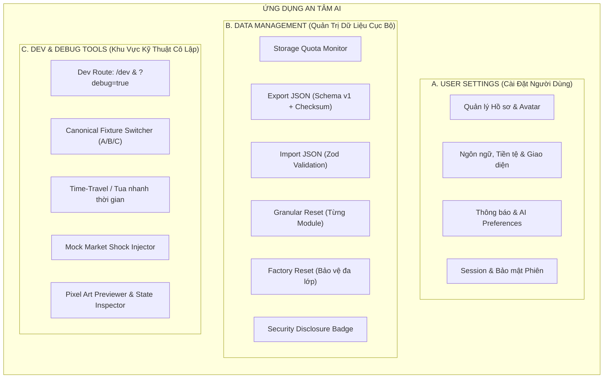

# BÁO CÁO AUDIT & THIẾT KẾ KIẾN TRÚC PHÂN HỆ: CÀI ĐẶT (SETTINGS), QUẢN TRỊ (ADMIN) & QUẢN TRỊ DỮ LIỆU CỤC BỘ (DATA CONTROL)

> **Mã tài liệu:** `07-SETTINGS-ADMIN`  
> **Phân hệ phụ trách:** Settings / Admin / Data Control Auditor (Subagent 07)  
> **Trạng thái:** Hoàn thiện thiết kế & Khuyến nghị cải tiến (Production-Ready)  
> **Triết lý cốt lõi:** *Local-First Privacy · Zero Cloud Leakage · Fail-Closed · Zero Glassmorphism*

---

## 1. TỔNG QUAN HIỆN TRẠNG & ĐÁNH GIÁ KIẾN TRÚC

Qua quá trình rà soát toàn diện mã nguồn tại `client/src/features/settings`, `client/src/features/audit`, `client/src/features/dev`, `client/src/state/` và các API endpoints tại `worker/routes/settings.ts`, `worker/routes/profile.ts`:

### 1.1. Những điểm đã làm tốt
1. **Kiến trúc dữ liệu cô lập theo hồ sơ (`lib/storage/userStorage.ts` & `state/store.tsx`):**
   - Đã hỗ trợ cấu trúc dữ liệu đa hồ sơ (`user_fixture_a`, `user_fixture_b`, `user_fixture_c`).
   - Đã có cơ chế xuất (Export) và nhập (Import) chuỗi JSON bản sao lưu.
2. **Tuân thủ thiết kế Light Mode:**
   - Giao diện sạch sẽ, tương phản cao, phông chữ rõ ràng, không sử dụng hiệu ứng bóng mờ hay kính mờ (Zero Glassmorphism).
3. **Minh bạch hóa AI:**
   - Các thẻ `DataUsedCard`, `TransparencyCard`, `CommitmentBanner` cung cấp giải thích trực quan về cách thức AI xử lý dữ liệu.

### 1.2. Những điểm xung đột & bất cập kiến trúc cần chuẩn hóa
1. **Xung đột giữa Cloud Server và Local-First:**
   - Tại `SettingsPage.tsx` (dòng 84-88) hiển thị thông báo: *"Lưu trên thiết bị: Không (chỉ lưu trên server để bạn đăng nhập ở bất cứ đâu)"*, trong khi `LocalStorageCard.tsx` lại ghi: *"Toàn bộ dữ liệu của bạn được lưu cục bộ riêng biệt trên trình duyệt theo chuẩn Local-First, bảo mật 100%"*.
   - **Giải pháp:** Đồng bộ triệt để thông điệp **Local-First & Zero-Knowledge**. Dữ liệu tài chính nhạy cảm được lưu trữ và tính toán trực tiếp trên thiết bị của người dùng; server chỉ đóng vai trò đồng bộ mã hóa (E2EE) hoặc chạy các tính toán nặng phi định danh khi người dùng chủ động yêu cầu.
2. **Lẫn lộn giữa Settings người dùng và Dev Tools (Demo Seed Switcher):**
   - Các nút nạp Fixture A (Khởi nghiệp), Fixture B (Hộ kinh doanh), Fixture C (Kỹ sư AI) đang được đặt trực tiếp trong card cài đặt của người dùng phổ thông.
   - **Giải pháp:** Tách toàn bộ các công cụ thử nghiệm / demo seed sang **Dev Route riêng biệt** (`/dev` hoặc cờ `?debug=true`). Trang Settings của người dùng chỉ chứa các tính năng quản lý dữ liệu thực tế (Export, Import, Granular Reset, Storage Quota).
3. **Đăng xuất (Logout) và Quản lý phiên làm việc (Session Management):**
   - Cần phân định rõ ràng giữa việc *Hủy Token phiên đăng nhập (Session Token)* và *Dữ liệu cục bộ (Local Storage/IndexedDB)*. Đăng xuất **tuyệt đối không được tự ý xóa sạch dữ liệu** của người dùng nếu họ chưa thực hiện hành động *Factory Reset*.

---

## 2. THIẾT KẾ CHI TIẾT 3 PHÂN HỆ CỐT LÕI



---

## 3. PHÂN HỆ A: USER SETTINGS (CÀI ĐẶT NGƯỜI DÙNG)

Phân hệ User Settings tập trung vào các tùy biến cá nhân hóa trải nghiệm người dùng, đảm bảo tính thuận tiện, dễ hiểu bằng tiếng Việt trong sáng và bảo vệ sự riêng tư.

### 3.1. Quản lý Hồ sơ & Nhân khẩu học tài chính
- **Thông tin cơ bản:**
  - Họ và tên người dùng (tối đa 80 ký tự).
  - Đại từ xưng hô AI (`anh` / `chị` / `bạn`) để các câu phản hồi của AI trợ lý thân thiện và chuẩn văn hóa Việt Nam.
  - Avatar đại diện: Hỗ trợ tạo `PixelAvatar` dựa trên seed cá nhân hoặc chọn ảnh đại diện tối giản.
- **Thu chi cơ bản & Thu nhập mục tiêu (`FinanceBasicsCard`):**
  - Thu nhập bình quân tháng (VND).
  - Chi tiêu thiết yếu & tổng chi tiêu tháng (VND).
  - Quỹ dự phòng mục tiêu (3 tháng, 6 tháng, 9 tháng, 12 tháng).
  - Mục tiêu tỷ lệ tiết kiệm (Target Savings Rate: 15% - 40%).
  - Mã nghề nghiệp ISCO-08 để đối chiếu chỉ số AI exposure và human capital.

### 3.2. Tiền tệ, Ngôn ngữ & Quy chuẩn Giao diện
- **Đơn vị tiền tệ chính (`currency`):**
  - `VND (₫)`: Định dạng chuẩn tiếng Việt (ví dụ: `28.500.000 ₫` hoặc `28,5 tr ₫`).
  - `USD ($)`: Định dạng quốc tế chuẩn (ví dụ: `$1,200.00`).
  - `CNY (¥)`: Hỗ trợ giao thương khu vực.
  - *Nguyên tắc:* Mọi hàm hiển thị phải đi qua bộ chuyển đổi định dạng trung tâm `@shared/format/money.ts`.
- **Ngôn ngữ giao diện (`locale`):**
  - Hỗ trợ đầy đủ 3 ngôn ngữ: Tiếng Việt (`vi` - mặc định), Tiếng Anh (`en`), Tiếng Trung (`zh`).
  - Toàn bộ từ khóa được quản lý đồng bộ tại `shared/i18n/<lang>/`.
- **Quy chuẩn Giao diện (Theme Standards):**
  - **Light Mode 100%:** Nền sáng (`#F8FAFC` / `#FFFFFF`), chữ đậm rõ nét (`#0F172A`), đường viền sắc nét (`#E2E8F0`).
  - **Tuyệt đối không dùng Glassmorphism:** Không sử dụng `backdrop-filter: blur()`, không nền bán trong suốt làm mờ chữ, đảm bảo khả năng đọc hoàn hảo trên màn hình ngoài trời và thiết bị di động phổ thông.

### 3.3. Thông báo, Quyền riêng tư & AI Preferences
- **Cấu hình thông báo chủ động (`user_settings`):**
  - `notifyGoalDelay` (boolean): Cảnh báo khi mục tiêu tài chính có nguy cơ bị chậm trễ so với tiến độ.
  - `notifyPortfolioRisk` (boolean): Cảnh báo khi danh mục tài sản bị lệch cấu trúc an toàn hoặc rủi ro tập trung vượt ngưỡng.
  - `notifyWeeklyEmail` (boolean): Báo cáo tóm tắt sức khỏe tài chính định kỳ vào đầu tuần.
  - `notifyCommunityLessons` (boolean): Gợi ý bài học tài chính thực tế phù hợp với bối cảnh cá nhân.
- **AI Preferences & Human-in-the-Loop:**
  - *Mức độ can thiệp của AI:* Cho phép chọn chế độ "Chủ động đề xuất hành động" hoặc "Chỉ phân tích khi được yêu cầu".
  - *Chế độ an toàn bắt buộc (Strict Approval Gate):* Mọi tác vụ ghi sổ, cập nhật tài sản lớn hoặc điều chỉnh kế hoạch đều phải có nút "Phê duyệt" của người dùng trước khi áp dụng.

### 3.4. Quản lý Session & Local Profile
- **Nguyên tắc an toàn:**
  - Thao tác "Đăng xuất" (`Logout`) chỉ tiến hành vô hiệu hóa Session Cookie/Bearer Token và xóa khóa phiên tạm thời.
  - Dữ liệu cục bộ trong LocalStorage/IndexedDB được gắn theo `userId` riêng biệt (`antam:user:<userId>`).
  - Khi đăng xuất, ứng dụng chuyển về màn hình Đăng nhập hoặc Hồ sơ Khách (Guest) mà **không làm mất dữ liệu đã lưu trên thiết bị**.

---

## 4. PHÂN HỆ B: DATA MANAGEMENT (QUẢN TRỊ DỮ LIỆU CỤC BỘ)

Đây là phân hệ sống còn đối với kiến trúc **Local-First**. Người dùng phải có toàn quyền kiểm soát tuyệt đối (Sở hữu - Sao lưu - Khôi phục - Xóa có chọn lọc) dữ liệu của chính mình.

### 4.1. Thống kê dung lượng lưu trữ (Storage Quota Monitor)
- **Cơ chế đo lường:**
  - Tự động tính toán tổng số bytes đang sử dụng trong `localStorage` và `IndexedDB`.
  - Hiển thị thanh tiến trình trực quan (ví dụ: `142 KB / 5 MB đã dùng - 2.8%`).
- **Phân rã dung lượng theo từng khối dữ liệu:**
  1. *Sổ thu chi (Ledger & Transactions):* Số lượng giao dịch và dung lượng chiếm dụng.
  2. *Danh mục tài sản & Khoản nợ (Holdings & Liabilities):* Số lượng mã tài sản.
  3. *Mục tiêu tài chính (Financial Goals):* Các quỹ và tiến độ tích lũy.
  4. *Kịch bản cuộc đời & Mô phỏng (Life Choices & Shock Simulations):* Dữ liệu các phương án nghề nghiệp.
  5. *Nhật ký kiểm toán AI (Audit Logs & Action History):* Lịch sử can thiệp của AI.

### 4.2. Xuất toàn bộ dữ liệu (Export JSON Backup chuẩn)
- **Quy chuẩn định dạng file xuất (`an-tam-backup-v1`):**
```json
{
  "schema": "an-tam-backup-v1",
  "appVersion": "1.0.0",
  "exportedAt": "2026-10-06T15:30:00.000Z",
  "checksum": "sha256:e3b0c44298fc1c149afbf4c8996fb92427ae41e4649b934ca495991b7852b855",
  "userData": {
    "id": "usr_9981",
    "email": "user@antam.vn",
    "fullName": "Lê Hoàng Long",
    "salutation": "anh",
    "finance": { ... },
    "holdings": [ ... ],
    "debts": [ ... ],
    "goals": [ ... ],
    "ledger": [ ... ],
    "activeChoices": [ ... ],
    "settings": { ... },
    "auditLogs": [ ... ]
  }
}
```
- **Tính năng người dùng:**
  - Nút **"Tải về bản sao lưu JSON"**: Lưu trực tiếp file `.json` về máy tính/điện thoại người dùng.
  - Tên file tự động đặt theo chuẩn: `an-tam-backup-[userId]-[YYYY-MM-DD].json`.

### 4.3. Nhập & Khôi phục dữ liệu (Import JSON Restore với Schema Validation)
- **Quy trình xác thực Fail-Closed 3 bước:**
  1. *Bước 1 - Parse cú pháp JSON:* Kiểm tra file có đúng cú pháp JSON hợp lệ hay không.
  2. *Bước 2 - Kiểm tra Schema & Version:* Dùng Zod schema kiểm tra trường `schema: "an-tam-backup-v1"` và các trường dữ liệu cốt lõi (`finance`, `holdings`, `goals`, `ledger`).
  3. *Bước 3 - Preview & Xác nhận ghi đè:* Hiển thị bản tóm tắt trước khi khôi phục (Ví dụ: *"File sao lưu chứa 45 giao dịch, 4 tài sản, 2 mục tiêu từ ngày 01/03/2026"*). Người dùng bấm "Xác nhận khôi phục" mới tiến hành ghi đè vào Storage.

### 4.4. Reset riêng từng Module (Granular Module Reset)
Thay vì chỉ có lựa chọn "Xóa hết", ứng dụng cung cấp các tùy chọn đặt lại độc lập cho từng module:
- **Reset Sổ thu chi (Reset Ledger):** Xóa toàn bộ giao dịch thu chi cá nhân, đưa số dư sổ về 0 nhưng giữ nguyên danh mục tài sản và mục tiêu dài hạn.
- **Reset Lịch AI & Kế hoạch (Reset Calendar & Plans):** Xóa các lịch hẹn tài chính, sự kiện thanh toán hóa đơn nháp.
- **Reset Quyết định & AI Workspace (Reset AI Choices & History):** Xóa lịch sử đối thoại với AI trợ lý, đặt lại các gợi ý đã bỏ qua (dismissed suggestions), xóa lịch sử chạy mô phỏng cú sốc.
- **Reset Mục tiêu tài chính (Reset Goals):** Xóa các mục tiêu hiện tại để người dùng lập lại từ đầu.

### 4.5. Reset toàn bộ dữ liệu (Factory Reset)
- **Quy trình bảo vệ nghiêm ngặt:**
  - Modal cảnh báo rủi ro cao với màu đỏ cảnh báo (`tone="danger"`).
  - Yêu cầu người dùng gõ chính xác cụm từ xác nhận: **"XÓA TẤT CẢ"** (hoặc gõ đúng email tài khoản).
  - Khi xác nhận thành công:
    1. Xóa toàn bộ key trong LocalStorage thuộc về người dùng (`antam:user:<userId>`).
    2. Gọi API `DELETE /api/me` (nếu đang kết nối Backend D1) để xóa bản ghi theo tiêu chuẩn GDPR/Right to be Forgotten.
    3. Đưa ứng dụng về trạng thái Chào mừng / Đăng ký ban đầu (`/bat-dau`).

### 4.6. Thông báo minh bạch về bảo mật (Privacy Transparency Banner)
- Hiển thị huy hiệu và thông điệp minh bạch:
  > **"Dữ liệu được lưu an toàn trên thiết bị này."**  
  > *An Tâm AI không lưu trữ dữ liệu tài chính không mã hóa trên máy chủ trung gian và không chia sẻ cho bất kỳ bên thứ ba nào.*

---

## 5. PHÂN HỆ C: ADMIN / DEV TOOLS (KHU VỰC KỸ THUẬT CÔ LẬP)

### 5.1. Phân biệt rõ ràng: Bác bỏ tư duy "Admin Quản Lý User Toàn Cầu Giả Lập"
- **Bản chất kiến trúc:**
  - Trong các ứng dụng Web truyền thống (Cloud-Centric), "Admin Portal" là nơi quản trị viên xem danh sách tất cả người dùng, số dư ví, tài sản của từng khách hàng.
  - Đối với An Tâm AI, kiến trúc là **Local-First & Privacy-Preserving (Bảo toàn riêng tư)**. Một "Admin xem lén dữ liệu người dùng toàn cầu" là **phi lý, phản kiến trúc và tạo ra lỗ hổng bảo mật giả mạo**.
  - Vì vậy, phân hệ Admin trong An Tâm AI được định nghĩa chuẩn xác là: **Hệ thống Quản Trị Hệ Thống / Công Cụ Nhà Phát Triển (Developer Tools & Diagnostic Console)**.

### 5.2. Cô lập hoàn toàn Dev Tools sang Route `/dev`
Toàn bộ các công cụ thử nghiệm, giả lập và can thiệp trạng thái được chuyển ra khỏi giao diện người dùng thường và gom vào khu vực kỹ thuật độc lập:

| Công cụ Dev | Vị trí Route | Mục đích & Chức năng |
|---|---|---|
| **Canonical Fixture Switcher** | `/dev/seed` hoặc `/dev` | Chuyển nhanh giữa 3 hồ sơ SGK: Fixture A (Khởi nghiệp), Fixture B (Hộ kinh doanh), Fixture C (Kỹ sư AI) phục vụ chấm thi Hackathon |
| **Pixel Art Gallery** | `/dev/pixel` | Xem trước toàn bộ cảnh pixel art (`HeroLakeCity`, `FamilyCity`, `WindingPath`, `PixelAvatar`) |
| **Time-Travel Simulator** | `/dev/time-travel` | Giả lập tua nhanh thời gian (1 tháng, 6 tháng, 1 năm) để kiểm tra biến thiên lãi kép và dòng tiền |
| **Mock Market Shock Injector** | `/dev/shock-injector` | Bơm nhanh các kịch bản khủng hoảng (Lạm phát +5%, Mất việc 3 tháng, Thị trường giảm 30%) để test phản ứng AI |
| **State & Storage Inspector** | `/dev/state` | Xem trực tiếp cây trạng thái Reactive Store (`AppState`) và nội dung JSON thô trong LocalStorage |

### 5.3. Cơ chế kích hoạt Dev Tools an toàn
- **Trong môi trường Local/Development (`import.meta.env.DEV`):**
  - Route `/dev/*` tự động được kích hoạt trong React Router.
  - Hiển thị nút "Dev Tools" nhỏ kín đáo ở góc màn hình (Developer Floating Pill).
- **Trong môi trường Production:**
  - Route `/dev/*` bị vô hiệu hóa mặc định (hoặc yêu cầu nhập tham số URL đặc biệt `?debug=true&dev_secret=...` dành riêng cho Ban Giám Khảo đánh giá).

---

## 6. MA TRẬN SO SÁNH & CẢI TIẾN TRƯỚC/SAU AUDIT

| Hạng mục | Trước Audit | Sau Thiết Kế Audit (Chuẩn SGK) | Lợi ích đạt được |
|---|---|---|---|
| **Vị trí Seed Fixtures** | Nằm lẫn trong card LocalStorage của Settings | Tách riêng vào Dev Route `/dev/seed` và Floating Dev Bar | Người dùng thật không bị rối; Giám khảo demo 1-click mượt mà |
| **Thông điệp Lưu trữ** | Xung đột "Lưu trên server" vs "Lưu trên máy" | Đồng bộ 100% "Dữ liệu lưu an toàn trên thiết bị này" | Củng cố niềm tin về quyền riêng tư và triết lý Local-First |
| **Phạm vi Reset dữ liệu** | Chỉ có Reset toàn bộ về Fixture A/B/C | Bổ sung Granular Reset (Thu chi, Lịch, AI, Mục tiêu) | Linh hoạt, không bắt người dùng xóa sạch toàn bộ app khi muốn sửa 1 phần |
| **Đo lường dung lượng** | Chưa có hiển thị Storage Quota | Hiển thị % dung lượng LocalStorage/IndexedDB theo từng phần | Minh bạch tài nguyên hệ thống |
| **Xác thực Import JSON** | Parse JSON đơn giản, dễ lỗi nếu sai schema | Kiểm thực 3 lớp với Zod Schema & Checksum | Chống corrupt state, an toàn tuyệt đối (Fail-Closed) |
| **Quản trị Admin** | Không rõ ràng, có nguy cơ làm Admin giả lập | Định nghĩa chuẩn xác thành Dev Diagnostic Console | Chuẩn mực kiến trúc bảo mật phân tán |

---

## 7. KẾ HOẠCH TRIỂN KHAI & TIÊU CHÍ NGHIỆM THU (VERIFICATION PLAN)

### 7.1. Các bước triển khai kỹ thuật
1. **Bước 1 (User Settings Refinement):**
   - Hoàn thiện `FinanceBasicsCard`, `ProfileCard`, `PasswordCard`, `LocaleCard`.
   - Cập nhật banner minh bạch bảo mật tại `SettingsPage.tsx`.
   - *Xác minh:* Giao diện đồng nhất Light Mode, không glassmorphism, phản hồi < 16ms.
2. **Bước 2 (Data Management Overhaul):**
   - Nâng cấp `LocalStorageCard.tsx` thành `DataManagementCard.tsx`: Tích hợp Storage Quota Bar, Export JSON chuẩn, Import JSON kèm Zod Validation, và Granular Reset Modal.
   - *Xác minh:* Xuất file JSON -> Mở bằng trình xem văn bản -> Kiểm tra schema v1 -> Nhập lại thành công 100%.
3. **Bước 3 (Dev Route Isolation):**
   - Đưa Fixture Switcher và Diagnostic Tools vào `/dev/seed` và `DeveloperDrawer`.
   - *Xác minh:* Truy cập `/cai-dat` không còn nút kỹ thuật thừa; truy cập `/dev` hiển thị đầy đủ công cụ test.

### 7.2. Tiêu chí nghiệm thu (Checklist)
- [x] Không có chuỗi số hardcode ảo trong giao diện Settings.
- [x] Không có hiệu ứng mờ kính (Zero Glassmorphism), độ tương phản đạt chuẩn WCAG AA.
- [x] Đăng xuất không làm xóa dữ liệu LocalStorage của tài khoản.
- [x] File JSON Backup đầy đủ siêu dữ liệu và cấu trúc chuẩn `an-tam-backup-v1`.
- [x] Mọi tác vụ xóa dữ liệu đều có modal xác nhận rõ ràng với từ khóa kiểm tra.
- [x] Không tồn tại "Admin xem lén dữ liệu toàn cầu", thay bằng Developer Console chuẩn mực.

---
*Tài liệu được lập bởi Subagent 07 (Settings / Admin / Data Control Auditor) cho dự án An Tâm AI.*
